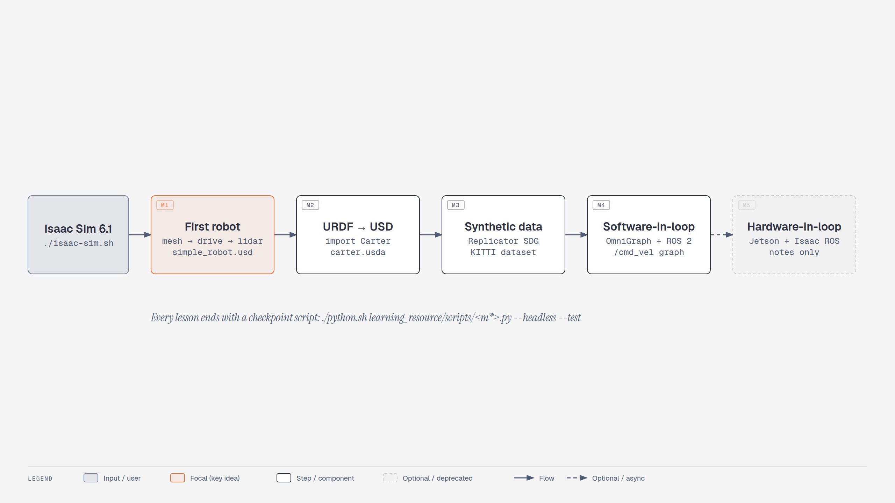

# Build a robot, drive it, and see what it sees

Start with a cube and four wheels. Add physics, take control with your keyboard, and watch lidar
measurements arrive in ROS 2. Then import Carter, generate labelled warehouse images, and connect
simulated sensors to robot software.

This hands-on course adapts NVIDIA's [Getting Started With Isaac Sim](https://docs.nvidia.com/learning/physical-ai/getting-started-with-isaac-sim/latest/)
learning path to **Isaac Sim 6.1.0-rc.26**. It contains **12 practical lessons** and an **optional
hardware-in-the-loop module**. Each practical lesson has a short narrated video, guided steps,
exercises, and a result to check.

**Read it online:** [saeedahmadicp.github.io/isaac-sim-6-getting-started](https://saeedahmadicp.github.io/isaac-sim-6-getting-started/) · **Source:** [github.com/saeedahmadicp/isaac-sim-6-getting-started](https://github.com/saeedahmadicp/isaac-sim-6-getting-started)

<a class="cta" href="module1_first_robot/lesson1_building_a_simple_robot.md">Build your first robot →</a>
<a class="cta ghost" href="#before-you-start">Check what you need</a>


*Build this in Module 1. Actual Isaac Sim 6.1 capture; camera, lights, and colours adjusted for clarity.*

> 🎬 **Video walkthrough:** [Course introduction](videos/00_course_intro.mp4) · ⏱ **Time:** 2 min

## Before you start

You should be comfortable opening a terminal and navigating files. Module 1 introduces the simulator
from scratch; you do not need to know the names of its panels or physics components yet. Later lessons
use ROS 2 commands and Python.

| You need | When you need it |
|---|---|
| A working Isaac Sim installation and compatible NVIDIA GPU | Before lesson 1.1; launch the app and open a blank scene |
| Internet access for NVIDIA robot and environment assets | When loading remote assets; the first load can take longer |
| ROS 2 command-line tools and RViz | Before lesson 1.4; follow [Set up ROS 2 Jazzy](01_setup_ros2_jazzy.md) |
| A Python background | Helpful for the synthetic-data and scripting lessons |
| Isaac ROS container setup | For the external perception continuation after lesson 4.3 |
| A Jetson | Only for the optional hardware exercise in Module 5 |

The reference setup is Ubuntu 24.04, Isaac Sim 6.1.0-rc.26, and ROS 2 Jazzy. Check your version with
`cat VERSION` from the Isaac Sim installation folder. If you are following NVIDIA's older videos,
keep the [4.5 → 6.1 guide](00_whats_different_in_6.1.md) nearby; the blue change notes explain differences
at the steps where they matter.

### Get the course files

The checkpoint scripts expect this course to sit in a `learning_resource/` folder **inside your Isaac
Sim installation**, next to `isaac-sim.sh` and `python.sh`:

```bash
cd ~/isaacsim                                   # your Isaac Sim installation folder
git clone https://github.com/saeedahmadicp/isaac-sim-6-getting-started.git learning_resource
python3 learning_resource/site/serve.py         # optional: browse the course at http://127.0.0.1:8765/site/
```

## Choose your next result

| Module | What you will make | Start here |
|---|---|---|
| 1 · Your first robot | A robot built from shapes, driven by keyboard, with a lidar feed in ROS 2 | [Build, drive, and sense](module1_first_robot/README.md) |
| 2 · Work with robot assets | A drivable Carter imported from URDF, then a comparison with Nova Carter | [Import Carter](module2_urdf_carter/README.md) |
| 3 · Perception data | A small randomized pallet-jack dataset whose images and labels you can inspect | [Generate and inspect data](module3_sdg/README.md) |
| 4 · Connect robot software | ROS 2 motion commands, Python scenes, and camera images for a perception pipeline | [Connect the control loop](module4_sil/README.md) |
| 5 · Optional hardware extension | A plan and connection checks for moving robot software to a Jetson | [Explore hardware-in-the-loop](module5_hil/README.md) |

**New to simulation?** Follow Modules 1 and 2 first. Module 3 is a perception-data branch; it is not a
prerequisite for the ROS 2 control lessons in Module 4. Module 5 requires additional hardware for the
full exercise, but includes a same-PC clock exercise.



## Learn by predicting, trying, and checking

1. **See the destination.** Read the lesson goal and watch the short overview. The video introduces
   the workflow; use the written steps for the hands-on work.
2. **Make a prediction.** Before changing a drive, joint, or sensor setting, decide what you expect
   to happen. Write down a speed, direction, or visible change.
3. **Try one change.** Run the scene and compare the result with your prediction. Unexpected motion
   is useful evidence: use the troubleshooting table to narrow down the cause.
4. **Keep your result.** Save the scene and complete the checks before moving on. The final exercise
   asks you to change something without following every click again.

Lesson 1.1 is estimated at 45–60 minutes. Later pages show their own hands-on estimates; allow extra
time for installation, asset downloads, and shader compilation.

## When you get stuck

Several lessons have [checkpoint scripts](scripts/) that build a reference scene or test an output.
Compare the reference with your work: which joint, setting, or graph connection differs?
Some lessons share a script; camera/container and hardware exercises still need manual checks.

Run commands from your Isaac Sim installation folder:

```bash
./isaac-sim.sh
# In a separate terminal, after closing the GUI if GPU memory is limited:
./python.sh learning_resource/scripts/m1_build_simple_robot.py --headless --test
```

A checkpoint tests the behavior described on its lesson page. It does not replace the manual GUI,
keyboard, RViz, container, and hardware exercises.

## Course files and local website

The Markdown lessons are the editable source. The [website instructions](site/README.md) explain how
to serve the course and rebuild it after an edit. Videos, diagrams, checkpoint scripts, and generated
scenes live in the sibling `videos/`, `diagrams/`, `scripts/`, and `output/` folders.

Keep your own scene filenames separate from checkpoint outputs so you can compare them later.

## Credits and notices

This is an **unofficial, community adaptation** of NVIDIA's free
[Getting Started With Isaac Sim](https://docs.nvidia.com/learning/physical-ai/getting-started-with-isaac-sim/latest/)
learning path. It is not affiliated with or endorsed by NVIDIA. NVIDIA, Isaac Sim, Omniverse, Jetson
and related names are trademarks of NVIDIA Corporation.

- `scripts/m3_palletjack_sdg.py` is ported from
  [NVIDIA-AI-IOT/synthetic_data_generation_training_workflow](https://github.com/NVIDIA-AI-IOT/synthetic_data_generation_training_workflow)
  (MIT License, © 2022 NVIDIA Corporation); its header keeps that notice.
- The Carter URDF and meshes used in Module 2 belong to Isaac Sim and are **not** included here; lesson 2.1
  copies them from your own installation.
- Robot, environment and prop assets are streamed from NVIDIA's asset server at run time under Isaac Sim's
  own license terms.
- Narration in the videos was generated with ElevenLabs; diagrams were drawn for this course.

