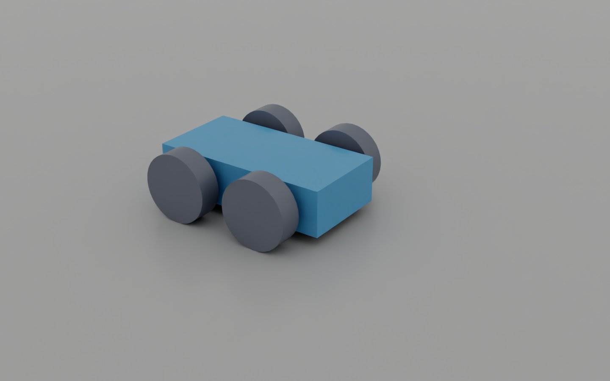
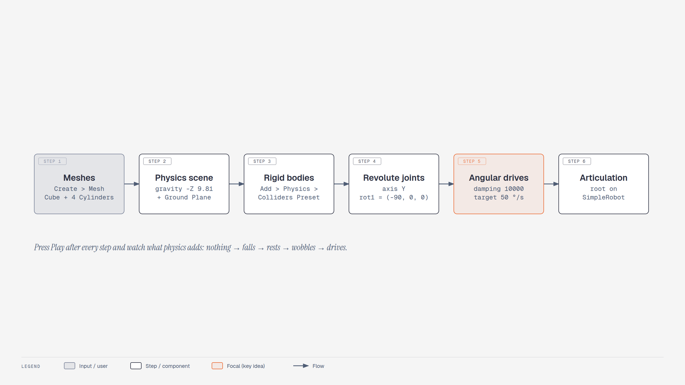
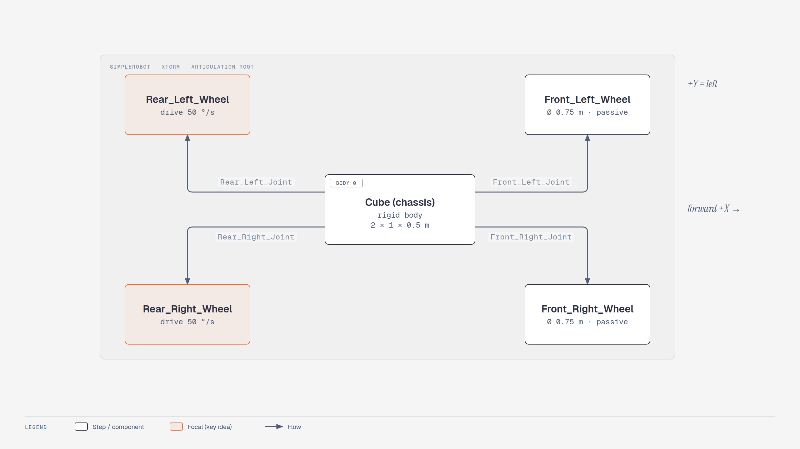
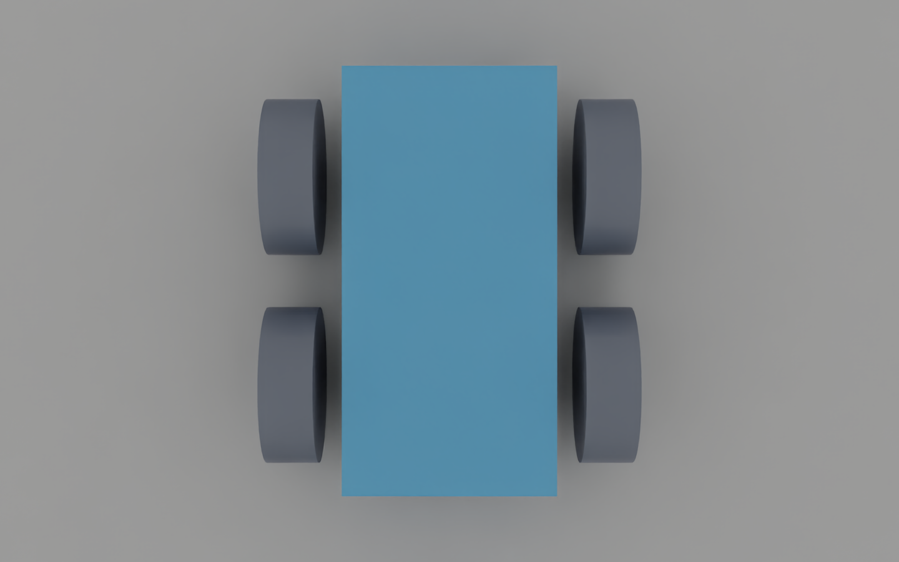
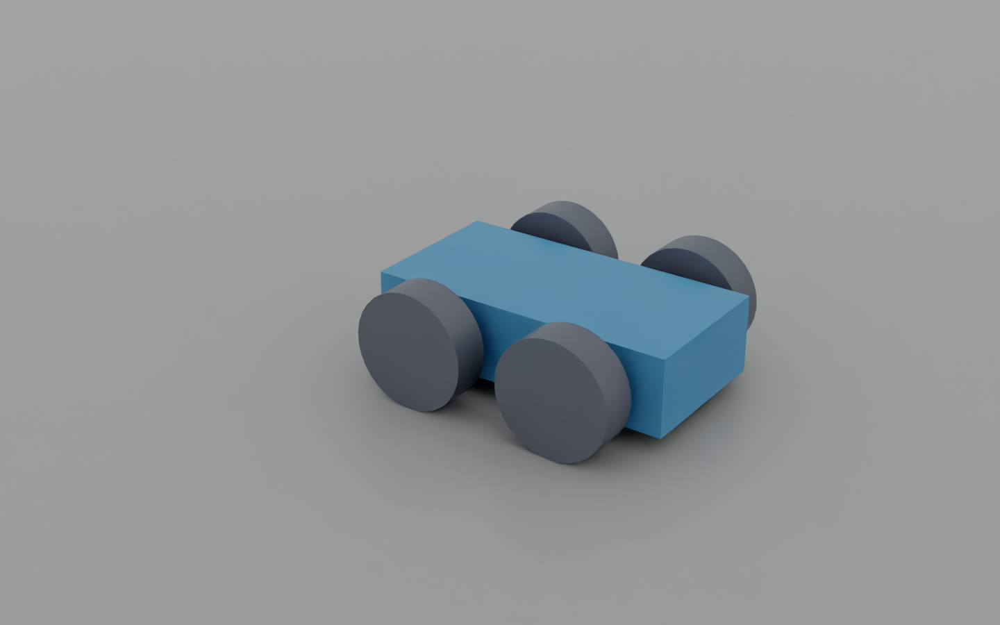

# Lesson 1.1: Building a Simple Robot (Isaac Sim 6.1)

Your first robot starts as five separate shapes. By the end of this lesson, its wheels will stay
attached, support the chassis, and drive it across the floor. Along the way, you will deliberately
make a cube fall and a robot fall apart so you can see what each physics component contributes.

**Your finish line:** save a four-wheeled robot that drives forward when you press Play.
**Before you begin:** launch Isaac Sim and start a new scene. No ROS 2 setup or Python coding is needed
for the GUI exercise. Allow 45–60 minutes, plus first-launch loading time.

**Expected result:** with the rear drives at 50 °/s the robot moves about **0.96 m in 3 simulated
seconds** (50 °/s × 0.375 m ≈ 0.33 m/s). The checkpoint script measures exactly this.


*Your destination: a frame rendered from the checkpoint scene in Isaac Sim 6.1.
Camera, lighting, and display colours were adjusted for readability; geometry and physics were unchanged.*

<!-- tutorial:start -->

> 🎬 **Video walkthrough:** [`1.1_building_a_simple_robot.mp4`](../videos/1.1_building_a_simple_robot.mp4) (captions burned in; text: [`.srt`](../videos/subtitles/1.1_building_a_simple_robot.srt)) · ⏱ **Time:** 45–60 min

**You will learn to**

- Navigate the viewport and read the Stage / Property panels
- Tell **visual meshes** from **physics** (rigid bodies, colliders, physics scene)
- Connect bodies with **revolute joints** and drive them with **angular drives**
- Group bodies into an **articulation** that controllers can address


*The six-step ladder from mesh to driving robot — [interactive HTML](../diagrams/m1-build-ladder.html)*

You only need three ideas to begin: the Stage panel lists the objects, the Property panel changes the
selected object, and Play starts the simulation. The rest will make sense as you build.

<!-- tutorial:end -->

## Part 1: Launch and navigate

```bash
cd ~/isaacsim   # your Isaac Sim installation folder (contains isaac-sim.sh and python.sh)
./isaac-sim.sh
```

> 🔄 **6.1:** there is no `isaac-sim.selector.sh` and no Start button. The ROS 2 bridge
> loads by itself with bundled Jazzy libraries, so leave it on (the course says to disable it in 4.5).

The first launch takes a few minutes while shaders compile. Later launches are faster.

Viewport navigation hasn't changed:

| Action | Input |
|---|---|
| Fly | hold **RMB** + `W A S D`, `Q`/`E` down/up |
| Look around | hold **RMB** and drag |
| Zoom | mouse wheel, or **Alt + RMB** |
| Pan | hold **MMB** and drag |
| Frame selection | `F` |

The default stage has **World** and **defaultLight** in the *Stage* panel (top right). The *Property*
panel (bottom right) shows whatever you select.

## Part 2: Make a cube fall, then catch it

**Predict first:** if you draw a cube and press Play, will it fall? Try it before adding physics.
Keep the simulation stopped while editing; after each experiment, press Stop to reset the scene.

1. **Create > Mesh > Cube**.
2. Press **Play** (▶ on the left toolbar, or `Space`). The cube stays still. Press **Stop**.
3. **Create > Physics > Physics Scene**. The default is Earth gravity along −Z (see the axis gizmo,
   bottom left).
4. Press **Play**. Still nothing. **Stop** before adding the rigid body.
5. Right-click **Cube** in the Stage panel → **Add > Physics > Rigid Body with Colliders Preset**.
6. Viewport toolbar **eye icon (Show by type) > Physics > Colliders > Selected**. A green collision
   outline appears.
7. **Play**. The cube falls because it now has a rigid body, but there is no floor to catch it. **Stop**.
8. **Create > Physics > Ground Plane**. Expand **GroundPlane** to see `CollisionMesh` and `CollisionPlane`.
9. Select the cube and set *Property > Transform > Translate Z* = **1**.
10. **Play**. The cube lands on the ground. **Stop** (■) resets it.
11. (Optional) Select *PhysicsScene* and change *Gravity Direction*, then play.
12. **File > Save As…** → e.g. `learning_resource/output/my_simple_robot.usd`.

**What changed?** A visible mesh gives the cube its appearance. A rigid body gives it simulated
motion; a collider gives it a shape that can hit the ground. The physics scene supplies gravity and
simulation settings. Adding one does not replace the others.

**Check before continuing:** the cube falls onto the ground and Stop returns it to its starting pose.

## Part 3: Turn the cube into a chassis

The Stage is a tree of *prims*, the objects and containers in a USD scene. An `Xform` is a container
with a position, rotation, and scale. Group the robot's parts beneath one so you can place them together.

1. Select the cube and set Translate **(0, 0, 0)**, Scale **(2, 1, 0.5)**.
2. Right-click empty space in the Stage panel → **Create > Xform**. Double-click it and rename it to **SimpleRobot**.
3. Drag **Cube** onto **SimpleRobot**, so the cube becomes its child.
4. Select **SimpleRobot** and set Translate Z = **1**. The cube moves with it (the Xform is a container).
5. Set **SimpleRobot** Translate Z back to **0** for now. You lift the whole robot in Part 5.

## Part 4: Add wheels and discover what is missing


*Use this map to distinguish front/rear and left/right while naming the parts.*

1. Right-click **SimpleRobot** → **Create > Mesh > Cylinder**.
2. Set the cylinder's transform:

    | Rotate | Scale | Translate |
    |---|---|---|
    | X **90** | **0.75, 0.75, 0.25** | **0.5, 0.75, 0** |

3. Rename it **Front_Left_Wheel**.
4. Duplicate it three times (**Ctrl+D**) and rename and position the copies:

    | Name | Translate |
    |---|---|
    | Front_Left_Wheel | 0.5, **0.75**, 0 |
    | Front_Right_Wheel | 0.5, **−0.75**, 0 |
    | Rear_Left_Wheel | **−0.5**, 0.75, 0 |
    | Rear_Right_Wheel | **−0.5**, −0.75, 0 |

    Wheel diameter = 0.75 m, so the radius is **0.375 m**. That is larger than half the
    0.5 m chassis height: the wheels should touch the ground while the chassis stays above it.

5. Make sure all four wheels **and** the Cube are children of SimpleRobot.
6. Select the 4 wheels → right-click → **Add > Physics > Rigid Body with Colliders Preset**.
   Do the same for **Cube** if you started a fresh stage.
7. Before pressing **Play**, predict whether the wheels will stay attached. Try it: the pieces are
    separate rigid bodies, with no joints to connect them. **Stop**, then **File > Save**.

You have a robot-shaped collection of objects. Next you will give the connections a physical meaning.


*Compare your layout with this capture from the completed checkpoint. The robot's +X/front points up;
left wheels are on the left. At this stage your own wheels still need joints.*

## Part 5: Keep the wheels attached while letting them turn

A revolute joint connects two bodies while allowing rotation around one axis. For a wheel, that axis
must follow its axle. Here it is Y. The wheel was rotated 90° about X, so its local joint frame needs
a −90° correction to align with the chassis frame.

For **each** wheel:

1. Click **Cube**, then **Ctrl+click** the wheel (body 0 = Cube, body 1 = wheel; order matters).
2. Right-click → **Create > Physics > Joint > Revolute Joint**.
3. On the new joint, set:

    * **Axis** = **Y**
    * **Local Rotation 0** = **0, 0, 0**
    * **Local Rotation 1** = **−90, 0, 0**

4. Deselect and reselect the joint. The red (X) arrows of both frames line up and the blue (Z) arrows
   match. Arrow direction doesn't matter.
5. Rename it **Front_Left_Joint**, **Front_Right_Joint**, **Rear_Left_Joint**, **Rear_Right_Joint**.
   In 6.1 the joint is created *under the wheel*. You can drag it under SimpleRobot to keep the tree tidy.

Finally, select **SimpleRobot** and set Translate Z = **0.375**, so the wheels rest on the ground plane.

**Check before continuing:** press Play. The wheels should stay attached, and the chassis should rest
above the floor. It does not drive yet. Stop before adding the motors.

## Part 6: Give the rear wheels a motor

A joint allows motion; a drive asks for motion. With stiffness set to zero, the drive responds to a
velocity target. Damping controls that response. The target below is in **degrees per second**.

**Predict first:** both rear wheels will receive +50 °/s. Will the robot move forward or spin?

1. Right-click **Rear_Left_Joint** → **Add > Physics > Angular Drive**.
2. Set **Damping = 10000**, **Stiffness = 0**, **Target Velocity = 50** (degrees per second).
3. Repeat for **Rear_Right_Joint**.
4. **Play**. The robot drives forward along +X.
5. **File > Save**.

**Explain the result:** both wheels turn in the same direction, so the robot travels forward. With
wheel radius 0.375 m, the ideal rolling speed is `(50 × π / 180) × 0.375 ≈ 0.33 m/s`.
This estimate assumes rolling without slip; it is a useful comparison, not an exact promise.

**Try one change:** set one rear drive to −50 °/s and leave the other at +50 °/s. Predict the motion,
then press Play. Stop and restore both to +50 before saving.

<details><summary>Why does the robot turn?</summary>
The driven wheels now try to roll in opposite directions. This produces a turning motion rather than
both sides moving forward together. Contact friction and the passive front wheels affect the actual turn.
</details>


*After 3 simulated seconds the chassis has moved about 0.96 m along +X. Compare with
its starting position above: the camera did not move. This was driven by the rear joint motors.*

## Troubleshooting

| Symptom | Fix |
|---|---|
| Robot drags or bounces | Wheels must reach lower than the body (check wheel scale 0.75 and Z = 0) |
| Wheels fly off or wobble | Joint **Body 0 / Body 1** swapped (should be Cube → wheel), or Local Rotation 1 isn't −90, 0, 0 |
| Robot spins instead of moving forward | One drive has the opposite sign |
| Something odd | Disable joints one at a time (*Joint Enabled* checkbox) to find the bad one |

## Compare with the checkpoint

```bash
./python.sh learning_resource/scripts/m1_build_simple_robot.py                        # watch it drive
./python.sh learning_resource/scripts/m1_build_simple_robot.py --headless --test --save learning_resource/output/simple_robot.usd
```

Save your own scene first. Then **File > Open** `learning_resource/output/simple_robot.usd` and compare
its joints with yours. The checkpoint also adds an **Articulation Root**, which groups the connected
bodies and joints for the controller used in lesson 1.2. Your manual scene adds it in that next lesson.

<!-- practice:start -->

## Check your result

| Do this | You should see |
|---|---|
| Cube alone, Play | nothing happens (no physics yet) |
| Cube with rigid body, no ground | falls forever |
| Robot with joints, no drives | rests on its wheels |
| Rear drives at 50 °/s | drives along +X at ≈ 0.33 m/s |
| `m1_build_simple_robot.py --headless --test` | `[m1] PASS: robot drove forward` |

## Exercises

1. Set the rear drives to **+50 / −50 °/s**. What happens, and why?
2. Change the wheel scale to 1.0 (Ø 1 m). Predict the new speed, then measure it (select Cube → Property → Rigid Body → Linear Velocity while playing).
3. Add drives to the **front** joints too (4-wheel drive). Does it go faster? Why not?
4. Swap Body 0 and Body 1 on one joint and watch what breaks — then undo it.

## Quiz

1. Why does a cube with only a Rigid Body (no collider) fall through the ground?
   <details><summary>Answer</summary>Collisions need a collision shape on both prims; the rigid body only adds dynamics.</details>

2. Stiffness 0, damping 10000, target velocity 50 — position or velocity drive?
   <details><summary>Answer</summary>Velocity drive: with zero stiffness only the velocity error produces torque.</details>

3. In what unit is the angular drive's Target Velocity?
   <details><summary>Answer</summary>Degrees per second.</details>

<!-- practice:end -->

## Your next mission

You can make the robot move, but its speed is fixed in the joint properties. In
[lesson 1.2](lesson2_controlling_the_robot.md), connect a controller and use the keyboard to choose
when to drive and turn. Save your scene before moving on.

<details><summary>Following the original NVIDIA course?</summary>
This lesson corresponds to “Building Your First Robot → Building a Simple Robot.” See the
[original learning path](https://docs.nvidia.com/learning/physical-ai/getting-started-with-isaac-sim/latest/)
and the [6.1 differences](../00_whats_different_in_6.1.md) when the video menus differ from your screen.
</details>
