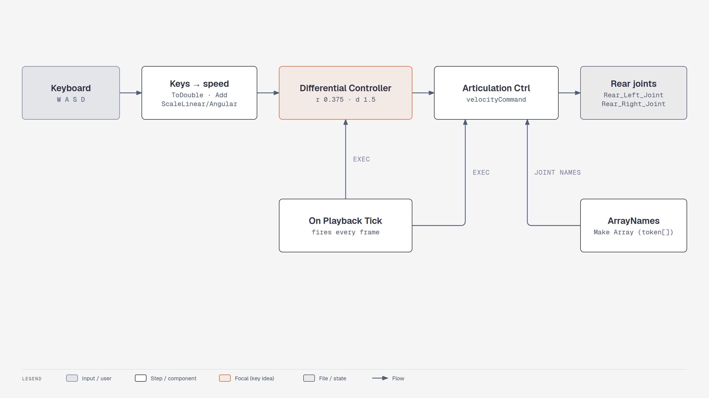

# Lesson 1.2: Controlling the Robot (Isaac Sim 6.1)

Course page: *Building Your First Robot → Controlling the Robot* (`…/02-controlling-the-robot.html`)

**Goal:** replace the fixed drive velocities with a **Differential Controller** Action Graph, first
driven from the Property panel and then from **W A S D**.

**Checkpoint script:** `scripts/m2_import_carter.py` builds this exact graph in code (on Carter, lesson 2.2).
The menu tool used below is the same in 4.5 and 6.1.


<!-- tutorial:start -->

> 🎬 **Video walkthrough:** [`1.2_controlling_the_robot.mp4`](../videos/1.2_controlling_the_robot.mp4) (captions burned in; text: [`.srt`](../videos/subtitles/1.2_controlling_the_robot.srt)) · ⏱ **Time:** 30 min

**You will learn to**

- Read an **Action Graph** (OmniGraph): execution vs data connections
- Use the **Differential Controller** tool to generate a graph
- Map keyboard input to robot velocity


*The Differential Controller Action Graph — [interactive HTML](../diagrams/m1-diff-controller.html)*

## Concepts
**OmniGraph / Action Graphs.** Visual programs stored in the stage. *Execution* wires (white) say
*when* a node runs; *data* wires carry values. `On Playback Tick` fires once per simulated frame, so
anything connected to it runs every frame while the timeline plays — and never while stopped.

**Differential drive kinematics.** For wheel radius *r* and track width *d*, a body velocity
(*v* forward, *ω* turning) becomes wheel speeds

```
ω_left  = (v − ω·d/2) / r
ω_right = (v + ω·d/2) / r
```

That is all the `Differential Controller` node computes. Wrong *r* or *d* doesn't break the robot — it
just makes it drive at the wrong speed or turn by the wrong angle.

**Articulation Controller.** Takes per-joint commands (position, velocity or effort arrays) plus joint
names and writes them as drive targets on the articulation. It needs the articulation root to find joints.

<!-- tutorial:end -->

---

## Part 1: Differential Controller

1. Open your robot from lesson 1.1 (or `learning_resource/output/simple_robot.usd`).
2. Right-click **SimpleRobot** → **Add > Physics > Articulation Root**.
   The controller looks up joints through the articulation, so this has to happen first.
3. (Optional) Set the two rear drives' *Target Velocity* back to **0**, so only the controller moves the robot.
4. **Tools > Robotics > OmniGraph Controllers > Differential Controller**
   > 🔄 Same path as 4.5. In 4.2 it was *Isaac Utils > Common Omnigraphs*.
5. Fill in the dialog (6.1 field names):

    | Field | Value |
    |---|---|
    | graph path | leave default `/Graphs/differential_controller` |
    | Robot Prim | **SimpleRobot** (click *Add*/select in the picker) |
    | wheel radius | **0.375** (half the 0.75 m wheel) |
    | distance between wheels | **1.5** |
    | Left Joint Name | **Rear_Left_Joint** |
    | Right Joint Name | **Rear_Right_Joint** |
    | Left/Right Joint Index | leave −1 (names are used) |
    | Use Keyboard Control (WASD) | **off** for Part 1 |

6. Click **OK**. The Stage panel now has **Graphs > differential_controller**. Right-click it →
   **Open Graph** to see the nodes:

    * **On Playback Tick**: fires every frame
    * **Differential Controller**: (linear, angular) velocity → left/right wheel speeds
    * **Articulation Controller**: applies the wheel speeds to the joints
    * **ArrayNames** (a *Make Array* node): the two joint names as tokens. Add inputs to drive more joints
7. **Play**. Nothing moves, because *Desired Linear Velocity* = 0.
8. Select the **Differential Controller** node and set *Linear Velocity* = **1** (forward),
   **−1** (back), or *Angular Velocity* = **1** (turn). Keep values small.
   The robot may hop a bit, because there are no friction materials yet (same as in the course).

## Part 2: Keyboard control

Before rebuilding the graph, try a short prediction experiment. Keep the physical robot unchanged,
set linear velocity to zero, and command angular velocity 1 rad/s. Then double only the controller's
wheel-distance value from 1.5 to 3.0. Will it ask the wheels to turn faster or slower?

<details><summary>Hint and explanation</summary>
In the formula above, the turning term is proportional to the configured wheel distance. Doubling
that value doubles the requested wheel speeds for a pure turn. The physical track has not changed,
so ideal rolling predicts a faster turn; friction and slip affect the measured result. Restore 1.5
before continuing.
</details>

1. **Stop**. Delete the graph from Part 1 (right-click *differential_controller* → Delete).
2. **Tools > Robotics > OmniGraph Controllers > Differential Controller** again, with the same values
   as above, but tick **Use Keyboard Control (WASD)**.
3. Open the new graph. On the left you'll see four **Read Keyboard State** nodes (W, A, S, D).
   Each goes through *To Double* and *Add/Multiply*, and is then scaled by the two **Constant Double**
   nodes (`ScaleLinear`, `ScaleAngular`) before reaching the controller's linear/angular inputs.
4. **Play**, click into the viewport, and drive with **W A S D**.
5. Too fast or too slow? Change **ScaleLinear** / **ScaleAngular** (the speed each key gives).
6. **File > Save**.

> 🔄 **6.1 detail:** the keyboard nodes are `omni.graph.nodes.ReadKeyboardState`. If an old 4.x graph
> uses deprecated node names, `isaacsim.core.deprecation_manager` migrates them when you open the file.

## Troubleshooting

| Symptom | Fix |
|---|---|
| "Robot Prim" can't be picked / controller does nothing | Add **Articulation Root** to *SimpleRobot* first |
| Robot turns when it should go straight | Left/right joint names swapped |
| Keys do nothing | Click inside the viewport so it has keyboard focus, and make sure the simulation is **playing** |
| Robot wanders back and forth | Old fixed drive velocities (50) are still set. Set them to 0 |

<!-- practice:start -->

## Check your result

| Do this | You should see |
|---|---|
| Play with Linear Velocity 0 | robot stands still |
| Linear Velocity 1 | drives forward ≈ 1 m/s |
| Angular Velocity 1 | turns left (counter-clockwise from above) |
| Keyboard graph, hold W | drives forward; A/D turn |

## Exercises

1. Keep the wheel-distance setting correct and halve only the configured wheel radius. Predict the change in requested wheel speed for straight driving, test briefly, then restore 0.375 m.
2. Make **Shift+W** a faster forward key (the keyboard nodes accept a modifier).
3. Add the front joints to `ArrayNames` (4 names) and feed the controller output twice — what has to change in the graph?

## Quiz

1. Why does nothing happen in the graph while the simulation is stopped?
   <details><summary>Answer</summary>Everything hangs off On Playback Tick, which only fires while the timeline plays.</details>

2. What does the Articulation Controller need in order to find the joints?
   <details><summary>Answer</summary>An articulation root on the robot (and the joint names).</details>

3. v = 1 m/s, ω = 0, r = 0.375 m — wheel speed?
   <details><summary>Answer</summary>1 / 0.375 ≈ 2.67 rad/s on both wheels.</details>

<!-- practice:end -->
