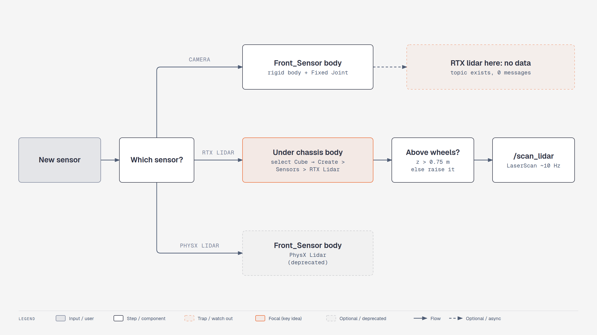

# Lesson 1.3: Adding Sensors (Isaac Sim 6.1)

Course page: *Building Your First Robot → Adding Sensors* (`…/03-adding-sensors.html`)

**Goal:** mount an **RGB camera** and a **2D lidar** on the robot and look at what they see.

**Checkpoint script:** `scripts/m1_ros2_lidar.py` (also covers lesson 1.4)
**Expected result:** an RTX 2D lidar on the chassis publishes `/scan_lidar` at ~10 Hz, and its forward beam reads 2.50 m to an obstacle placed 2.50 m ahead.

> 🔄 **Biggest change in this module.** The course uses a **PhysX Lidar** (*Create > Sensors > PhysX
> Lidar > Rotating*). In 6.1 that extension is **deprecated** (`extsDeprecated/isaacsim.sensors.physx`).
> It still appears in the menu, but this lesson uses its replacement, an **RTX Lidar** with the 2D
> config *Example Rotary 2D*. If you want to follow the video exactly, the PhysX steps are in the
> collapsible section at the end.


<!-- tutorial:start -->

> 🎬 **Video walkthrough:** [`1.3_adding_sensors.mp4`](../videos/1.3_adding_sensors.mp4) (captions burned in; text: [`.srt`](../videos/subtitles/1.3_adding_sensors.srt)) · ⏱ **Time:** 45 min

**You will learn to**

- Mount a **camera** on a fixed-jointed sensor body
- Add an **RTX lidar** (the 6.1 replacement of the PhysX lidar) in a place where it works
- Understand how RTX sensors see the scene (rendering, not physics)


*Where each sensor goes in Isaac Sim 6.1 — [interactive HTML](../diagrams/m1-sensor-mount.html)*

## Concepts
**Two kinds of lidar.** The course's *PhysX lidar* casts physics rays — it only hits **colliders**.
Isaac Sim 6.1's *RTX lidar* is simulated by the RTX renderer — it hits **everything rendered**, models
real sensor scan patterns (vendor configs like Ouster, Hesai, SICK) and outputs a *GenericModelOutput*
buffer that helper nodes turn into `LaserScan` / `PointCloud2`.

**Sensors ride on bodies.** A sensor prim follows whatever body it is parented to. Under a rigid body it
moves with that body; under a plain Xform beside the bodies it stays behind when the robot drives off.

**The 6.1 trap.** An RTX lidar under a *separate* rigid body that is fixed-jointed to the chassis produced
no output in our tests (topic exists, zero messages). Under the chassis body itself it works. Nova Carter
mounts all its sensors that way (`chassis_link/sensors/...`), so do the same.

**Units under a scaled parent.** `Cube` is scaled (2, 1, 0.5). A child's Translate is multiplied by that
scale: `(0.45, 0, 1.0)` → 0.9 m forward, 0.5 m up. The ranges the lidar reports are still in metres
(verified: an obstacle 2.50 m ahead reads 2.50 m).

<!-- tutorial:end -->

---

## Part 1: Sensor mount (Front_Sensor)

1. Right-click **SimpleRobot** → **Create > Xform**. Rename it **Front_Sensor**.
2. Move it to the top front of the body: Translate **(0.9, 0, 0.35)** (relative to SimpleRobot).
3. Right-click **Front_Sensor** → **Add > Physics > Rigid Body**.
   *Known issue (also in the course):* if Rigid Body can't be added, temporarily move Front_Sensor's
   children out, add it, then move them back.
4. Fixed joint to the chassis: click **Cube**, **Ctrl+click** **Front_Sensor** → right-click →
   **Create > Physics > Joint > Fixed Joint**. Check **Body 0 = Cube** and **Body 1 = Front_Sensor**.
   If they're swapped, fix them with the folder icon.
5. Right-click **Front_Sensor** → **Create > Mesh > Cube**, set Scale **(0.1, 0.1, 0.1)**, and rename it **Sensor_Mount**.
   (The course also adds *Rigid Body with Colliders Preset* to Sensor_Mount. A collider is enough. A second
   rigid body nested inside Front_Sensor isn't needed.)

## Part 2: RGB camera

1. Right-click **Sensor_Mount** → **Create > Camera**. Rename it **Robot_Camera**.
2. Point it forward: Rotate **Y = −90** (the course value). If the image is upside down or sideways,
   set Rotate to **(90, −90, 0)** instead (the value lesson 2.3 uses for Carter).
3. Move it to the front edge of the mount.
4. Look through it: at the top of the viewport, open the **camera menu** (shows *Perspective*) →
   **Cameras > Robot_Camera**. Switch back to **Perspective** when you're done.
   *Tip:* while you look through Robot_Camera, RMB+WASD moves the **camera prim**. Switch back before navigating.
5. Add some obstacles: **Create > Mesh > Cube / Cone / Cylinder**, spread out in front of the robot.
6. Two views at once:
   > 🔄 **Window > Viewports > Viewport 2** (4.2: *Window > Viewport > Viewport 2*). Set Viewport 1 to
   > *Perspective* and Viewport 2 to *Robot_Camera*.
7. **Play** and drive with W A S D. The camera view follows the robot.

## Part 3: 2D lidar (RTX)

> ⚠️ **6.1 trap, found while testing this lesson.** The course puts the lidar on **Front_Sensor**,
> a separate rigid body held by a Fixed Joint. In 6.1 an **RTX** lidar mounted on a fixed-jointed body
> **publishes nothing** (no errors, just no data). It works when the lidar sits **directly on the
> chassis body**, which is also how NVIDIA's Nova Carter mounts its sensors. The camera from Part 2
> is fine on Front_Sensor.

1. Select **Cube** (the chassis rigid body).
2. 🔄 **Create > Sensors > RTX Lidar > NVIDIA > Example Rotary 2D**
   (4.5 course: *Create > Sensors > PhysX Lidar > Rotating*). It's created as a child of Cube, named
   `Example_Rotary_2D`.
3. Set its **Translate = (0.45, 0, 1.0)**.
   These are **Cube-local** units. Cube is scaled (2, 1, 0.5), so this means 0.9 m forward and
   0.5 m above the chassis centre (≈ 0.875 m above the ground).
   *Why this high?* The wheel tops are at 0.75 m. A lidar below that sees the robot's own wheels
   (tested: at 0.725 m the closest "obstacle" was the rear wheel).
4. **Seeing the beams.** RTX lidars don't have the PhysX *Draw Lines / Draw Points* checkboxes.
   Ways to see the data:
   * **lesson 1.4**: publish to ROS 2 and view it in **RViz** (what the course does next anyway), or
   * from Python: attach the `draw-point-cloud` writer:
     ```python
     # Window > Script Editor, with the simulation stopped
     from isaacsim.sensors.experimental.rtx import Lidar, LidarSensor
     lidar = Lidar("/World/SimpleRobot/Cube/Example_Rotary_2D")
     sensor = LidarSensor(lidar, annotators=[])
     sensor.attach_writer("draw-point-cloud", size=0.05, color=[1.0, 0.2, 0.2, 1.0])
     ```
     Then press **Play**. Red points appear where the beams hit.
5. **Obstacle detection:** an RTX lidar sees **every rendered surface**, so the obstacles show up even
   *without* colliders. That's different from the PhysX lidar in the course. Still give them
   **Add > Physics > Rigid Body with Colliders Preset**, so the robot can't drive through them.
6. **File > Save.**

> **Placing prims by script?** Prims made with *Create > Mesh* have *translate / orient / scale* ops.
> `UsdGeom.XformCommonAPI(prim).SetTranslate(...)` **silently does nothing** on them. Set
> `prim.GetAttribute("xformOp:translate").Set(...)` instead. (This bit us while writing the checkpoint script.)

<details>
<summary>Course-exact alternative: PhysX Lidar (deprecated in 6.1)</summary>

1. Select **Front_Sensor** → **Create > Sensors > PhysX Lidar > Rotating** (the PhysX lidar is fine on Front_Sensor; the trap above is RTX-only).
2. Stop the simulation, select the lidar, open **Raw USD Properties**, and tick **drawLines** and **drawPoints**.
3. **Play**. Gray beams mean no hit, red beams mean a hit. PhysX lidar beams only hit **colliders**,
   so the obstacles need *Rigid Body with Colliders Preset*.
4. Slow the rotation (*rotationRate*) to inspect the beams. Raise the lidar if it hits the wheels.

Expect a deprecation warning in the console. The ROS 2 graph for this sensor (*Isaac Read Lidar Beams*,
`isaacsim.sensors.physx.IsaacReadLidarBeams`) is also deprecated.
</details>

<!-- practice:start -->

## Check your result

| Do this | You should see |
|---|---|
| Viewport → Cameras → Robot_Camera | you see the scene from the robot's front |
| Drive with W while in Viewport 2 = Robot_Camera | camera view moves with the robot |
| Lidar prim type in Property panel | `OmniLidar`, under `/World/SimpleRobot/Cube` |
| `m1_ros2_lidar.py --headless --test` | `forward beam = 2.50 m … PASS` |

## Exercises

1. Lower the lidar to Translate z = 0.7 and look at the scan in RViz (lesson 1.4). Where do the extra close points come from?
2. Swap *Example Rotary 2D* for **Create > Sensors > RTX Lidar > Ouster > OS1** and publish *Point Cloud* instead of *Laser Scan*.
3. Put a cone behind a glass-like thin plane without a collider. Which lidar type would see the plane — PhysX or RTX?

## Quiz

1. Does an RTX lidar need colliders on obstacles to detect them?
   <details><summary>Answer</summary>No — it renders the scene; colliders only matter for physical contact.</details>

2. Where must the RTX lidar be mounted on SimpleRobot in 6.1?
   <details><summary>Answer</summary>Directly under the chassis rigid body (Cube), not on the fixed-jointed Front_Sensor.</details>

3. Why place the lidar above 0.75 m?
   <details><summary>Answer</summary>Below the wheel tops the scan hits the robot's own wheels.</details>

<!-- practice:end -->
