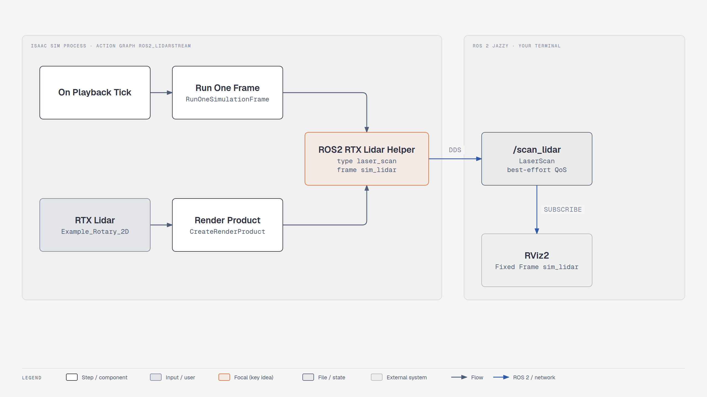

# Lesson 1.4: Accessing Data — Lidar to ROS 2 and RViz (Isaac Sim 6.1)

Course page: *Building Your First Robot → Accessing Data* (`…/04-accessing-data.html`)

**Goal:** publish the robot's 2D lidar as a ROS 2 `sensor_msgs/LaserScan` on `/scan_lidar` and view it in RViz.

**Checkpoint script:** `scripts/m1_ros2_lidar.py`
**Expected result:** about 10 LaserScan messages per second on `/scan_lidar` (frame `sim_lidar`, 3600 beams).
**Prerequisite:** system ROS 2 Jazzy for `ros2` and `rviz2`, see [`../01_setup_ros2_jazzy.md`](../01_setup_ros2_jazzy.md)


<!-- tutorial:start -->

> 🎬 **Video walkthrough:** [`1.4_ros2_and_rviz.mp4`](../videos/1.4_ros2_and_rviz.mp4) (captions burned in; text: [`.srt`](../videos/subtitles/1.4_ros2_and_rviz.srt)) · ⏱ **Time:** 45 min (+ ROS 2 install)

**You will learn to**

- Publish simulated sensor data on **ROS 2** topics
- Inspect topics with the `ros2` CLI and visualise them in **RViz2**
- Understand frames, QoS and domain IDs — the three usual reasons for 'no data'


*RTX lidar → ROS 2 LaserScan → RViz — [interactive HTML](../diagrams/m1-ros2-lidar.html)*

## Concepts
**ROS 2 in one paragraph.** Programs (*nodes*) exchange typed *messages* on named *topics* through DDS.
Nodes find each other automatically when they share a `ROS_DOMAIN_ID` and a compatible middleware (RMW).
Isaac Sim's bridge is just another node living inside the simulator.

**Frames.** Every sensor message carries `header.frame_id`. RViz draws data relative to its *Fixed
Frame*; if no transform connects the two, nothing is drawn. With only one frame (`sim_lidar`), set the
Fixed Frame to exactly that name.

**QoS.** Sensor streams are published *best-effort* (drop old data rather than queue it). `rviz2` and
`ros2 topic echo` adapt automatically; your own subscriber must use `qos_profile_sensor_data`.

**Bundled vs system ROS.** Isaac Sim loads its own Jazzy libraries (`exts/isaacsim.ros2.core/jazzy`).
System ROS is only needed for tools you run outside — and must be sourced in *those* terminals.

<!-- tutorial:end -->

---

## Part 1: ROS 2 (what changed)

| Course (4.5, Ubuntu 22.04) | 6.1 reference setup (Ubuntu 24.04) |
|---|---|
| Install ROS 2 **Humble** | Install ROS 2 **Jazzy** (only for `rviz2` / `ros2` CLI) |
| `source /opt/ros/humble/setup.bash` **before** `./isaac-sim.sh` | Not needed. Isaac Sim loads its bundled Jazzy libs. Just run `./isaac-sim.sh` |
| Enable the *ROS2 Bridge* in Window > Extensions | Already enabled at startup (`isaacsim.ros2.bridge`). Check it under **Window > Extensions** if unsure |
| Install `vision_msgs` | Bundled. Install `ros-jazzy-vision-msgs` on the system side only if a ROS tool needs it |

## Part 2: Open your project

1. `./isaac-sim.sh` → **File > Open Recent** → your robot from lesson 1.3.
2. (Optional) **Window > Viewports > Viewport 2** for a robot-camera view.

## Part 3: Build the lidar → ROS 2 graph

> 🔄 The course builds this by hand (*Isaac Read Lidar Beams → ROS2 Publish Laser Scan* +
> *Isaac Read Simulation Time*), and those nodes only work with the **PhysX** lidar. For the **RTX** lidar
> from lesson 1.3, 6.1 has a one-click graph builder.

**Stop** the simulation, then:

1. **Tools > Robotics > ROS 2 OmniGraphs > RTX Lidar**
2. Fill in the dialog:

   | Field | Value |
   |---|---|
   | Graph Path | `/World/ROS2_LidarStream` (the course's graph name) |
   | Frame ID | `sim_lidar` (remember this for RViz) |
   | Node Namespace | empty |
   | LaserScan Topic | `scan_lidar` |
   | Lidar Prim | pick your RTX lidar, `/World/SimpleRobot/Cube/Example_Rotary_2D` |
   | Laser Scan | ✅ ticked |
   | Point Cloud | optional (publishes `/point_cloud` as PointCloud2) |

3. **OK**. Open the graph to see what it made: *On Playback Tick* → *Isaac Run One Simulation Frame* →
   *Isaac Create Render Product* (the lidar) → **ROS2 RTX Lidar Helper** (type *laser_scan*), plus a
   *ROS2 Context*. The helper does the work of the course's *Read Lidar Beams + Publish Laser Scan +
   Read Simulation Time* chain.

> The *Laser Scan* output only works with a **2D** lidar config (*Example Rotary 2D*). For a 3D lidar,
> publish *Point Cloud* instead.

<details>
<summary>Course-exact manual graph (PhysX lidar only)</summary>

**Create > Visual Scripting > Action Graph**, rename it *ROS2_LidarStream*, and add: *On Playback Tick*,
*Isaac Read Lidar Beams Node*, *ROS2 Publish Laser Scan*, *Isaac Read Simulation Time*.
Connect Tick → Read Lidar Beams (exec), Read Lidar Beams outputs → matching Publish Laser Scan inputs
(exec, azimuthRange, depthRange, horizontalFov, horizontalResolution, intensitiesData, linearDepthData,
numCols, numRows, rotationRate), and Read Simulation Time → Publish Laser Scan *timeStamp*. Set the
lidar prim on Read Lidar Beams, `topicName = scan_lidar`, `frameId = sim_lidar`.
</details>

## Part 4: Run and view in RViz

1. **Play** in Isaac Sim.
2. New terminal:
   ```bash
   source /opt/ros/jazzy/setup.bash
   ros2 topic list            # expect /scan_lidar, /rosout, /parameter_events
   ros2 topic hz /scan_lidar  # ~10 Hz
   rviz2
   ```
3. In RViz: **Global Options > Fixed Frame** = **`sim_lidar`**, typed in.
   (The course text says to use the topic name. That's wrong: Fixed Frame must be the **Frame ID**.)
4. **Add** (bottom left) → **By topic** → `/scan_lidar` → **LaserScan** → OK.
   Red points show the obstacles. Raise *Size (m)* to 0.05 if they're hard to see.
5. Drive with **W A S D** in Isaac Sim. In RViz the world moves around the fixed robot, because the scan
   is drawn in the lidar's own frame.
6. **File > Save**.

## Checkpoint

```bash
# needs learning_resource/output/simple_robot.usd (from m1_build_simple_robot.py --save ...)
./python.sh learning_resource/scripts/m1_ros2_lidar.py                    # leaves the sim running for RViz
./python.sh learning_resource/scripts/m1_ros2_lidar.py --headless --test  # subscribes to /scan_lidar itself
```

## Troubleshooting

| Symptom | Fix |
|---|---|
| No `/scan_lidar` in `ros2 topic list` | Simulation not **playing**, or different `ROS_DOMAIN_ID` in the two terminals |
| Topic listed but `ros2 topic echo` prints nothing | RMW mismatch. `export RMW_IMPLEMENTATION=rmw_fastrtps_cpp` in the ROS terminal |
| RViz: "Frame [sim_lidar] does not exist" / nothing drawn | Fixed Frame must be typed exactly `sim_lidar` |
| Scan shows a ring of points around the robot | Lidar is too low and sees the wheels/body. Raise it |
| "is not a valid RTX lidar prim" when creating the graph | You picked the Xform/mount, not the lidar prim (type *OmniLidar*) |
| `/scan_lidar` is listed but **no messages ever arrive** | The RTX lidar is on a fixed-jointed sensor body (lesson 1.3 trap). Move it directly under the chassis body |
| Messages arrive in `ros2 topic echo` but a custom subscriber gets none | QoS: the scan is published best-effort. Subscribe with `qos_profile_sensor_data` |

<!-- practice:start -->

## Check your result

| Do this | You should see |
|---|---|
| `ros2 topic list` while playing | `/scan_lidar` is listed |
| `ros2 topic hz /scan_lidar` | ≈ 10 Hz |
| `ros2 topic echo /scan_lidar --once` | `frame_id: sim_lidar`, 3600 ranges |
| RViz, Fixed Frame `sim_lidar`, LaserScan display | points on your obstacles |

## Exercises

1. Tick *Point Cloud* in the RTX Lidar graph dialog too and add a **PointCloud2** display in RViz.
2. Run `export ROS_DOMAIN_ID=7` in the RViz terminal only. What happens? Fix it.
3. Write a 15-line rclpy node that prints the closest range in front of the robot (remember `qos_profile_sensor_data`).

## Quiz

1. RViz says 'Frame [sim_lidar] does not exist'. What do you change?
   <details><summary>Answer</summary>Set Global Options → Fixed Frame to `sim_lidar` (the frame id, not the topic).</details>

2. Do you need to source /opt/ros/jazzy before ./isaac-sim.sh?
   <details><summary>Answer</summary>No — 6.1 uses its bundled Jazzy libraries.</details>

3. `ros2 topic echo` shows data but your node gets nothing. Likely cause?
   <details><summary>Answer</summary>QoS mismatch: subscribe with the sensor-data (best-effort) profile.</details>

<!-- practice:end -->
