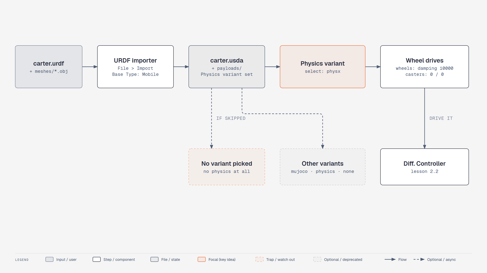
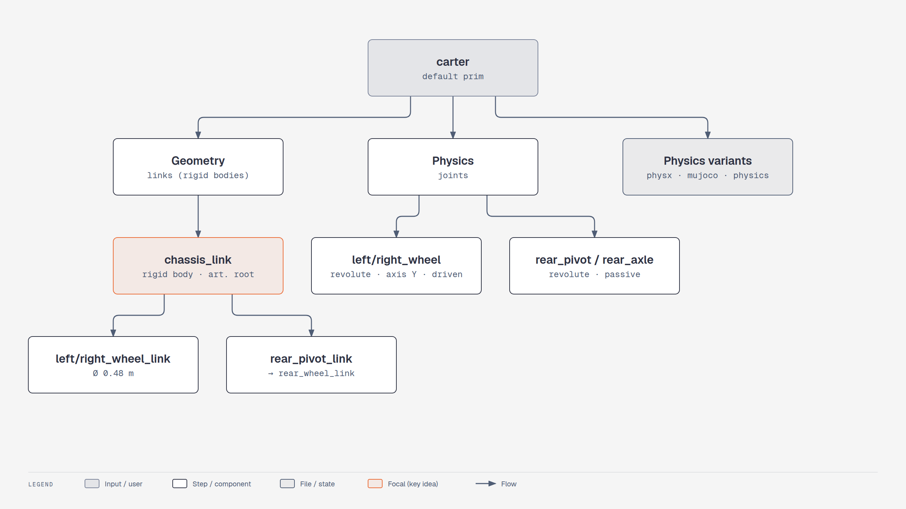

# Lesson 2.1: Importing URDF Assets (Isaac Sim 6.1)

Course page: *Ingesting Robot Assets and Simulating Your Robot → Importing URDF Assets*
(`…/ingesting-robot-assets-and-simulating-your-robot-in-isaac-sim/01-importing-urdf-assets.html`)

**Goal:** import **Carter** (two drive wheels plus a passive caster) from `carter.urdf` and get a USD robot
with correct drives.

**Checkpoint script:** `scripts/m2_import_carter.py` (lessons 2.1 + 2.2)
**Expected result:** the imported Carter drives about **0.6 m in 3 s** at 0.2 m/s with a Differential Controller.


<!-- tutorial:start -->

> 🎬 **Video walkthrough:** [`2.1_importing_urdf.mp4`](../videos/2.1_importing_urdf.mp4) (captions burned in; text: [`.srt`](../videos/subtitles/2.1_importing_urdf.srt)) · ⏱ **Time:** 30 min

**You will learn to**

- Import a **URDF** with the rewritten 6.1 importer
- Understand the generated asset: payloads, **Physics variant set**, Geometry vs Physics scopes
- Configure joint **drives** by hand (the 6.1 dialog no longer does it)


*URDF → drivable USD robot in 6.1 — [interactive HTML](../diagrams/m2-urdf-pipeline.html)*


*What the 6.1 importer writes — [interactive HTML](../diagrams/m2-carter-structure.html)*

## Concepts
**URDF vs USD.** URDF (ROS) describes *links* (rigid parts with visuals/collisions/inertia) and *joints*
(how links move relative to each other). USD describes a *scene*. The importer maps links → rigid body
Xforms under `Geometry`, joints → `PhysicsRevoluteJoint`/… under `Physics`.

**Layered assets.** The 6.1 converter writes `carter.usda` (the entry file) plus `payloads/`
(`base`, `geometries`, `materials`, `Physics/physx|mujoco|physics`). Layers let one asset carry several
physics descriptions; a **variant set** called `Physics` chooses which one is loaded. No selection = no
physics layer = a robot that neither falls nor moves.

**Drives after import.** URDF has no notion of "this joint is motorised with gain X", so the importer
creates angular drives with zero gains. You decide: wheels → velocity drives (stiffness 0, damping > 0),
casters → passive (both 0).

<!-- tutorial:end -->

---

## Get the URDF

You don't need the course's `carter.zip`. The same Carter URDF ships with Isaac Sim 6.1. Copy it into
the course folder once, so the importer writes its output next to your course files instead of inside
Isaac Sim's own extension folder:

```bash
cd ~/isaacsim   # your Isaac Sim installation folder
mkdir -p learning_resource/assets
cp -r exts/isaacsim.asset.importer.urdf/data/urdf/robots/carter learning_resource/assets/
```

You now have `learning_resource/assets/carter/urdf/carter.urdf` and `…/carter/meshes/*.obj`.
(The checkpoint script does this copy automatically if the folder is missing. The files are part of
Isaac Sim and are not redistributed with this course.)

## Import (6.1 workflow)

> 🔄 **The 6.1 importer is a rewrite** (`isaacsim.asset.importer.urdf` 3.x, based on the open-source
> *urdf-usd-converter*). The menu is still **File > Import**, but the options changed:
>
> | 4.5 | 6.1 |
> |---|---|
> | *Links → Moveable base* | **Options → Base Type → Mobile** |
> | *Joints and Drives → Natural Frequency* + per-joint *Target Type* | **gone from the dialog**: set drives after import (Part 3) |
> | One `.usd` file, imported into your stage | A **folder** `carter/carter.usda` + `payloads/`, **opened as a new stage** unless *Add Reference to Stage* is ticked |

1. `./isaac-sim.sh`, then **File > New**.
2. **File > Import** → browse to `learning_resource/assets/carter/urdf/` → select **carter.urdf**.
3. The options panel on the right:

   | Section | Option | Value |
   |---|---|---|
   | Model | USD Output | leave *Same as Imported Model (Default)* → writes `assets/carter/urdf/carter/carter.usda`. Or pick `learning_resource/output/` |
   | Model | ROS Package List | leave empty (the meshes use `package://carter/...`, found by scanning the folders) |
   | Colliders | Collision From Visuals | off (the URDF has its own collision shapes) |
   | Colliders | Allow Self-Collision | **off** |
   | Options | Robot Type | *Default* (or *Wheeled Robot*, if listed) |
   | Options | **Base Type** | **Mobile** |
   | Options | Add Reference to Stage | off for now (the robot opens on its own, so you can inspect it) |
   | Options | Merge Mesh / Debug Mode | off |

4. Click **Import**. After a few seconds the converted `carter.usda` opens as the current stage.

## What you get: the 6.1 asset structure

Expand **carter** in the Stage panel:

```
carter                          (default prim, has a "Physics" variant set)
├── Geometry
│   └── chassis_link            (rigid body + ArticulationRoot)
│       ├── left_wheel_link
│       ├── right_wheel_link
│       ├── rear_pivot_link
│       │   └── rear_wheel_link
│       ├── com_offset, imu
├── Physics                     (joints live here, not under the links)
│   ├── left_wheel   right_wheel   rear_pivot   rear_axle   (revolute)
│   └── root_joint …
├── Materials / VisualMaterials
```

### ⚠️ Select the physics variant

Select **carter** → *Property* panel → **Variants** → **Physics** = **physx**.

The importer writes one physics layer per engine (`physx`, `mujoco`, `physics` = plain USD Physics,
`none`). Until you pick one, the joints and rigid bodies aren't loaded, and the robot won't move.

## Part 3: Set the drives (replaces "Joints and Drives" from 4.5)

The importer gives every revolute joint an *Angular Drive* with **stiffness 0 and damping 0**, so nothing
is driven yet. Set them by hand to match the course (wheels = Velocity, caster joints = None):

| Joint (`/carter/Physics/…`) | Course target type | 6.1 setting in *Property > Drive > Angular* |
|---|---|---|
| `left_wheel` | Velocity | **Stiffness 0**, **Damping 10000** |
| `right_wheel` | Velocity | **Stiffness 0**, **Damping 10000** |
| `rear_pivot` | None | Stiffness 0, Damping 0 (passive) |
| `rear_axle` | None | Stiffness 0, Damping 0 (passive) |

*Velocity drive* = stiffness 0, damping > 0: the joint tracks *Target Velocity*.
*Position drive* = stiffness > 0. *None* = both 0.

**File > Save** (this saves into the `carter.usda` layer you have open).

> Scripted alternative: `URDFImporterConfig` accepts `joint_target_type`, `override_joint_stiffness` and
> `override_joint_damping` (per joint via a dict). The GUI just doesn't expose them.

## Checkpoint

```bash
./python.sh learning_resource/scripts/m2_import_carter.py                     # import + scene + drive, with a window
./python.sh learning_resource/scripts/m2_import_carter.py --headless --test   # self-check
```

The script writes `learning_resource/output/carter/carter.usda`. You can reference that file in later lessons.

<!-- practice:start -->

## Check your result

| Do this | You should see |
|---|---|
| Stage panel after import | `carter > Geometry`, `Physics`, `Materials` |
| carter → Property → Variants | Physics = **physx** |
| left_wheel → Drive | stiffness 0, damping 10000 |
| `m2_import_carter.py --headless --test` | `[m2] PASS: Carter drove forward` |

## Exercises

1. Open `learning_resource/output/carter/payloads/Physics/physics.usda` in a text editor and find the `left_wheel` joint. Which body is body0?
2. Switch the variant to **mujoco** and press Play. What happens with the PhysX engine running?
3. Re-import with *Base Type = Fixed*. What changed in `Physics/`?

## Quiz

1. The imported Carter doesn't fall when you press Play. First thing to check?
   <details><summary>Answer</summary>The Physics variant — select physx.</details>

2. Where are the joints in the 6.1 asset?
   <details><summary>Answer</summary>Under `/carter/Physics/`.</details>

3. Which gains make a joint a velocity drive?
   <details><summary>Answer</summary>Stiffness 0 and damping > 0.</details>

<!-- practice:end -->
