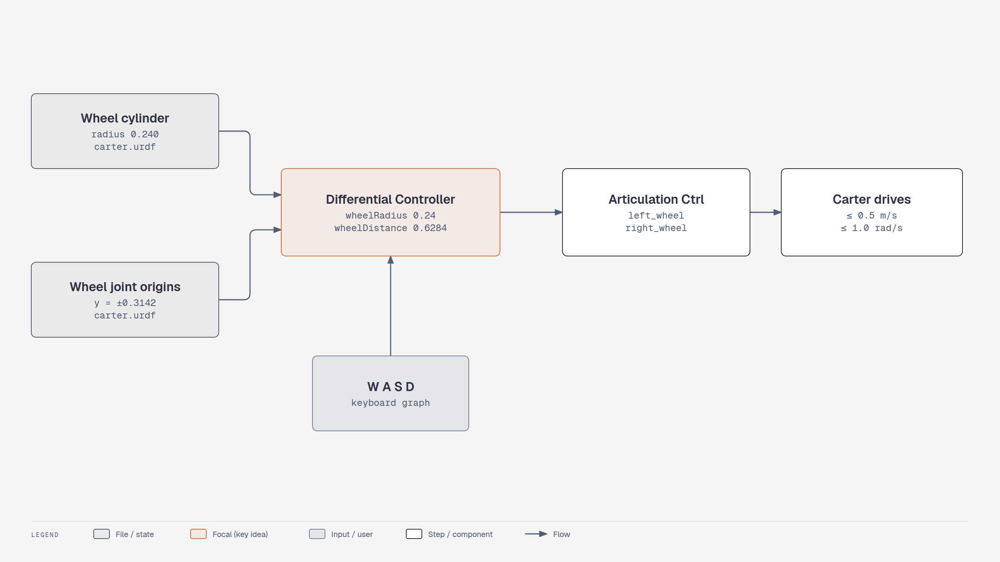

# Lesson 2.2: Preparing the Simulation (Isaac Sim 6.1)

Course page: *Ingesting Robot Assets → Preparing the Simulation* (`…/02-preparing-the-simulation.html`)

**Goal:** put Carter in an environment, check its joints, and drive it with **W A S D** through a
Differential Controller.

**Checkpoint script:** `scripts/m2_import_carter.py`

<!-- tutorial:start -->

> 🎬 **Video walkthrough:** [`2.2_preparing_the_simulation.mp4`](../videos/2.2_preparing_the_simulation.mp4) (captions burned in; text: [`.srt`](../videos/subtitles/2.2_preparing_the_simulation.srt)) · ⏱ **Time:** 30 min

**You will learn to**

- Compose a scene from referenced assets
- Read controller parameters straight out of the URDF
- Limit speeds so a controller behaves

*Where the Differential Controller numbers come from — [interactive HTML](../diagrams/m2-carter-drive.html)*

## Concepts
**References.** Dragging `carter.usda` into a stage creates a *reference*: the robot's data stays in its
file, your scene stores only "load that file here" plus your overrides (position, variant choice, drive
gains you change later). That's why the variant must be selected again per reference.

**Parameters from the source.** The controller needs wheel radius and track width. Don't guess — the URDF
says: wheel `<cylinder radius="0.240">` and wheel joints at `y = ±0.3142` → track 0.6284 m.

**Saturation.** Keyboard graphs command step changes; without `maxLinearSpeed` / `maxAngularSpeed` the
wheels saturate, slip and the robot hops. Limits are a cheap way to keep a sim stable.

<!-- tutorial:end -->

---

## Part 1: Environment

> 🔄 The importer opened `carter.usda` as its own stage. Build a scene **around** it instead:

1. **File > New**.
2. 🔄 **Create > Environments > Flat Grid** (4.2: *Create > Isaac > Environments > Flat Grid*).
3. Add the robot to this stage, either way works:
   * drag `carter.usda` from the **Content** browser (bottom panel) into the viewport, or
   * **File > Import** `carter.urdf` again with **Add Reference to Stage** ticked.
4. Select the new **carter** prim → **Variants > Physics = physx** (the variant choice is stored per
   reference, so set it again here).
5. Turn off the scene's environment light by clicking the 👁 next to it in the Stage panel (optional, as in the course).
6. Raise Carter a little: *Transform > Translate Z* = **0.05**.
7. **Play**. Carter drops onto the grid. **Stop**.
8. Hide collision outlines: viewport **eye > Physics > Colliders > None**.

## Part 2: Joint review

All joints are under **carter > Physics** (4.5: a *joints* folder, 4.2: under *chassis_link*):

| Joint | Body 0 | Body 1 | Axis |
|---|---|---|---|
| left_wheel | chassis_link | left_wheel_link | Y |
| right_wheel | chassis_link | right_wheel_link | Y |
| rear_pivot | chassis_link | rear_pivot_link | Z (caster swivel) |
| rear_axle | rear_pivot_link | rear_wheel_link | Y |

## Part 3: Quick drive test (no controller)

1. Select **left_wheel** and **right_wheel** → *Drive > Angular > Target Velocity* = **20** (°/s).
   (They need the velocity drive from lesson 2.1: stiffness 0, damping 10000.)
2. **Play**. Carter rolls forward slowly (20 °/s × 0.24 m ≈ 0.08 m/s).
3. While it's playing, set one wheel back to **0**. Carter turns.
4. **Stop** and set both targets back to **0**.

> The course's *"Articulation Root fix (4.2 only)"* is **not needed**: the 6.1 importer already puts
> the articulation root on `chassis_link` with self-collisions off.

## Part 4: Differential Controller with keyboard

1. **Tools > Robotics > OmniGraph Controllers > Differential Controller**:

   | Field | Value | Where it comes from |
   |---|---|---|
   | Robot Prim | **carter** | |
   | wheel radius | **0.24** | wheel collision cylinder radius in the URDF |
   | distance between wheels | **0.62** (exact: 0.6284) | 2 × the 0.3142 m wheel Y offset |
   | Left Joint Name | **left_wheel** | |
   | Right Joint Name | **right_wheel** | |
   | Use Keyboard Control (WASD) | ✅ | |

2. **OK** → Stage panel **Graphs > differential_controller** → right-click → **Open Graph**.
3. **Play**, click the viewport, and drive with **W A S D**.

## Part 5: Speed limits

The keyboard graph commands large speeds, and Carter becomes erratic. Select the
**Differential Controller** node in the graph and set:

| Property | Value |
|---|---|
| maxLinearSpeed | **0.5** m/s (the course used 0.2 in 4.5 and 0.5 in 4.2) |
| maxAngularSpeed | **1.0** rad/s |

Check it: select **chassis_link** → *Property > Rigid Body* velocity while holding **W**. It should stay under the limit.

**File > Save As…** `learning_resource/output/carter_scene.usd`.

## Troubleshooting

| Symptom | Fix |
|---|---|
| Carter doesn't fall / doesn't react | **Physics variant** not set to `physx` on this reference |
| Wheels spin but Carter doesn't move | Wheels intersect the grid: raise Carter, or check the drives have damping |
| Carter spins in place with W | One of the joint names is wrong in the controller dialog |
| Caster wheel fights the motion | rear_pivot / rear_axle must be **passive** (stiffness 0, damping 0) |

<!-- practice:start -->

## Check your result

| Do this | You should see |
|---|---|
| Play after adding the reference | Carter drops onto the grid and rests |
| Both wheel targets 20 °/s | ≈ 0.08 m/s straight |
| Keyboard graph, hold W | ≤ 0.5 m/s (chassis_link → Rigid Body velocity) |

## Exercises

1. Set *wheel radius* to 0.12 (half the real value) and drive forward at 0.2 m/s. Measure the real speed. Why is it double?
2. Make the casters slightly damped (damping 10). Is turning smoother or worse?
3. Save the scene, close Isaac Sim, edit `carter.usda`'s drive gains in a text editor and reopen — does your scene pick up the change? (That's what references buy you.)

## Quiz

1. Why must the physics variant be selected again in a new scene?
   

Answer
The selection is an override stored on the referencing prim, not in carter.usda.

2. Where does wheelDistance 0.6284 come from?
   

Answer
2 × the wheel joint y-offset 0.3142 in the URDF.

3. Why limit maxLinearSpeed?
   

Answer
Keyboard steps saturate the wheels and make the robot slip and hop.

<!-- practice:end -->
