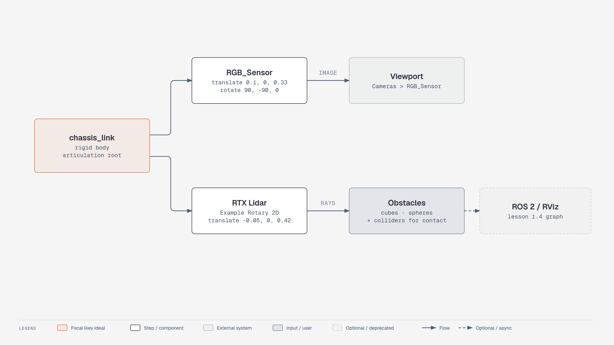

# Lesson 2.3: Adding Sensors to Carter (Isaac Sim 6.1)

Course page: *Ingesting Robot Assets → Adding Sensors* (`…/03-adding-sensors.html`)

**Goal:** add an RGB camera and a lidar to the imported Carter and see obstacles with both.

Start from your Carter scene from lesson 2.2 (`learning_resource/output/carter_scene.usd`).

<!-- tutorial:start -->

> 🎬 **Video walkthrough:** [`2.3_adding_sensors.mp4`](../videos/2.3_adding_sensors.mp4) (captions burned in; text: [`.srt`](../videos/subtitles/2.3_adding_sensors.srt)) · ⏱ **Time:** 30 min

**You will learn to**

- Apply the module-1 sensor rules to an imported robot
- Edit a referenced asset (and know when your edits land in which file)

*Sensors on the imported Carter — [interactive HTML](../diagrams/m2-carter-sensors.html)*

## Concepts
**Where do edits go?** Adding a prim under a *referenced* robot writes an override into your **scene**
file, not into `carter.usda`. Usually that's what you want (the sensor belongs to this experiment). To make
the sensor part of the robot asset, open `carter.usda` itself and add it there.

**Sensor frames.** Camera prims look down their local −Z with +Y up; the course's rotation `(90, −90, 0)`
turns that into "look along the robot's +X". If an image is sideways, it's always this rotation.

<!-- tutorial:end -->

---

## RGB camera

1. Move the viewport close to Carter.
2. **Create > Camera**. In the Stage panel, drag it under **carter > Geometry > chassis_link**.
   > 🔄 6.1 path: `carter/Geometry/chassis_link` (4.5: `Carter/chassis_link`).
   > If the reference won't accept children, that's because you're editing a referenced asset. Put the
   > camera in the same spot by opening `carter.usda` itself (**File > Open**) and saving it there.
   > Or keep the camera outside the robot and attach it with a fixed joint, as in lesson 1.3.
3. Rename it **RGB_Sensor**. Translate **(0.1, 0.0, 0.33)**, Rotate **(90, −90, 0)**.
   Turn off snapping (magnet icon, left toolbar) if the values jump.
4. Viewport camera menu → **Cameras > RGB_Sensor** to check the view. Switch back to **Perspective**.
5. **Play**, drive with **W A S D**, and confirm the camera moves with Carter. **Stop**.

## Lidar

> 🔄 Course: **Create > Isaac > Sensors > PhysX Lidar > Rotating** (4.2 path, PhysX lidar).
> 6.1: use the **RTX** lidar. Same reasons as lesson 1.3.

1. Select **chassis_link** → **Create > Sensors > RTX Lidar > NVIDIA > Example Rotary 2D**
   (for a 3D scan, use *Example Rotary* or a real model, e.g. *Ouster*, *HESAI*, *SICK*).
2. Make sure it's under **chassis_link**. Translate **(−0.05, 0.0, 0.42)**.
3. To *see* the beams, use the `draw-point-cloud` writer snippet from
   [lesson 1.3, Part 3](../module1_first_robot/lesson3_adding_sensors.md#part-3-2d-lidar-rtx), or publish to
   ROS 2 and view it in RViz ([lesson 1.4](../module1_first_robot/lesson4_ros2_and_rviz.md)).

## Obstacles

1. **Create > Mesh > Cube / Sphere / Cylinder**: place several around the grid at different
   distances and angles.
2. **Play**.
   * PhysX lidar (course): beams stay **gray** until the obstacles get colliders.
   * RTX lidar (6.1): obstacles are **detected right away**, because RTX sees rendered geometry.
3. **Stop**, select all obstacles → right-click → **Add > Physics > Rigid Body with Colliders Preset**
   (so Carter physically bumps into them).
4. **Play**, switch the viewport to **RGB_Sensor**, and drive with **W A S D**.
5. **Stop**, and switch back to **Perspective**. Otherwise navigating the viewport moves the camera prim.

**File > Save.**

<!-- practice:start -->

## Check your result

| Do this | You should see |
|---|---|
| Viewport → Cameras → RGB_Sensor | view from Carter's front |
| Lidar prim path | `…/chassis_link/Example_Rotary_2D` |
| Drive into an obstacle with colliders | Carter is stopped by it |

## Exercises

1. Publish this lidar to ROS 2 (lesson 1.4 dialog) and view it in RViz while driving.
2. Add a second camera looking backwards. Which rotation do you need?

## Quiz

1. You added a camera under the referenced carter. Which file stores it?
   

Answer
Your scene file (as an override), not carter.usda.

2. Why does the RTX lidar see obstacles without colliders?
   

Answer
It is rendered, not physics-based.

<!-- practice:end -->
