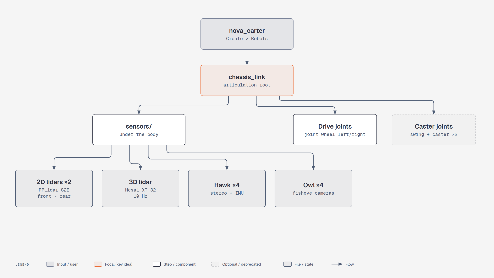

# Lesson 2.4: Accessing a Prepared Robot: Nova Carter (Isaac Sim 6.1)

Course page: *Ingesting Robot Assets → Accessing a Prepared Robot* (`…/04-accessing-a-prepared-robot.html`)

**Goal:** load NVIDIA's ready-made **Nova Carter**, which already has physics, drives and a full sensor
suite, and compare it with the Carter you built by hand.

<!-- tutorial:start -->

> 🎬 **Video walkthrough:** [`2.4_nova_carter.mp4`](../videos/2.4_nova_carter.mp4) (captions burned in; text: [`.srt`](../videos/subtitles/2.4_nova_carter.srt)) · ⏱ **Time:** 15 min

**You will learn to**

- Load a production robot asset
- Read a real sensor suite and joint layout

*Nova Carter's ready-made sensor suite — [interactive HTML](../diagrams/m2-nova-carter.html)*

## Concepts
**Why prepared assets?** Nova Carter took NVIDIA engineers tuned masses, drive gains, collision shapes,
materials and calibrated sensor models. For real projects you start here and only build robots yourself
when no asset exists (then via URDF → USD as in lesson 2.1).

**Robot-type layout.** Notice the pattern you will see in most 6.x robots: one articulation root body,
`sensors/` as plain Xforms beneath it, joints named `joint_*`.

<!-- tutorial:end -->

---

1. **File > New**.
2. 🔄 **Create > Environments > Flat Grid** (4.2: *Create > Isaac > Environments > FlatGrid*).
3. Hide the environment light (👁 in the Stage panel) if you like.
4. 🔄 **Create > Robots > Nova Carter with Sensors** (same as 4.5).
   It loads `/Isaac/Robots/NVIDIA/NovaCarter/nova_carter.usd` from the NVIDIA asset server. The first
   load can take a few minutes.
5. (Optional) The finished version of the URDF Carter, *Carter_v1*:
   🔄 **Window > Browsers > Isaac Sim Assets** → search **carter** → drag *Carter_v1* (or `carter_v1`)
   into the stage. (4.5: *Isaac Sim Assets [Beta]* panel.)

## Review the robot

Expand **nova_carter > chassis_link** in the Stage panel:

Checked in this install (6.1 `nova_carter.usd`). Everything below is under `chassis_link/sensors/`:

| Sensor | Prim | Type |
|---|---|---|
| 2 × 2D lidar (front / rear) | `front_RPLidar/RPLidar_S2E`, `rear_RPLidar/RPLidar_S2E` | RTX `OmniLidar` (Slamtec RPLidar S2E) |
| 1 × 3D lidar on top | `XT_32/PandarXT_32_10hz` | RTX `OmniLidar` (Hesai XT-32, 10 Hz) |
| 4 × Hawk stereo cameras | `front_hawk`, `left_hawk`, `right_hawk`, `back_hawk`, each with `left`/`right` cameras + an IMU | Camera + `IsaacImuSensor` |
| 4 × Owl fisheye cameras | `front_owl`, `left_owl`, `right_owl`, `back_owl` → `camera` | Camera |
| chassis IMU | `chassis_imu/Imu_Sensor` | `IsaacImuSensor` |

Drive and joints (`nova_carter/…`):

| Part | Joints |
|---|---|
| 2 driven wheels (radius 0.14 m, track 0.413 m) | `joint_wheel_left`, `joint_wheel_right` |
| 2 passive casters at the back | `joint_caster_base`, `joint_swing_left/right`, `joint_caster_left/right` |
| articulation root | `chassis_link`, the target for the Articulation Controller in lesson 4.1 |

Notice that every sensor sits **under the chassis body** (`chassis_link/sensors/...`), not on a separate
fixed-jointed body. That's the mounting that works for RTX lidars in 6.1 (see the trap in lesson 1.3).

Compare with your URDF Carter: Nova Carter comes with tuned drives, collision shapes, materials and
sensors, so there's no manual setup.

> In 6.1 you may see `Projection type 'fisheyePolynomial' is deprecated` warnings for the Owl/Hawk cameras
> in the console. They're harmless. The asset still works.

Next: drive Nova Carter from ROS 2 in [lesson 4.1](../module4_sil/lesson1_omnigraph_cmd_vel.md).

<!-- practice:start -->

## Check your result

| Do this | You should see |
|---|---|
| Create > Robots > Nova Carter with Sensors | `/World/nova_carter` appears |
| Expand chassis_link/sensors | front/rear RPLidar, XT_32, 4× Hawk, 4× Owl, chassis_imu |

## Exercises

1. Look through `front_hawk/left/camera_left` (Viewport camera menu).
2. Find the drive gains of `joint_wheel_left`. How do they compare with what you set on Carter?

## Quiz

1. Which prim is Nova Carter's articulation root?
   

Answer
`chassis_link`.

2. What type is the XT-32 prim?
   

Answer
An RTX `OmniLidar`.

<!-- practice:end -->
