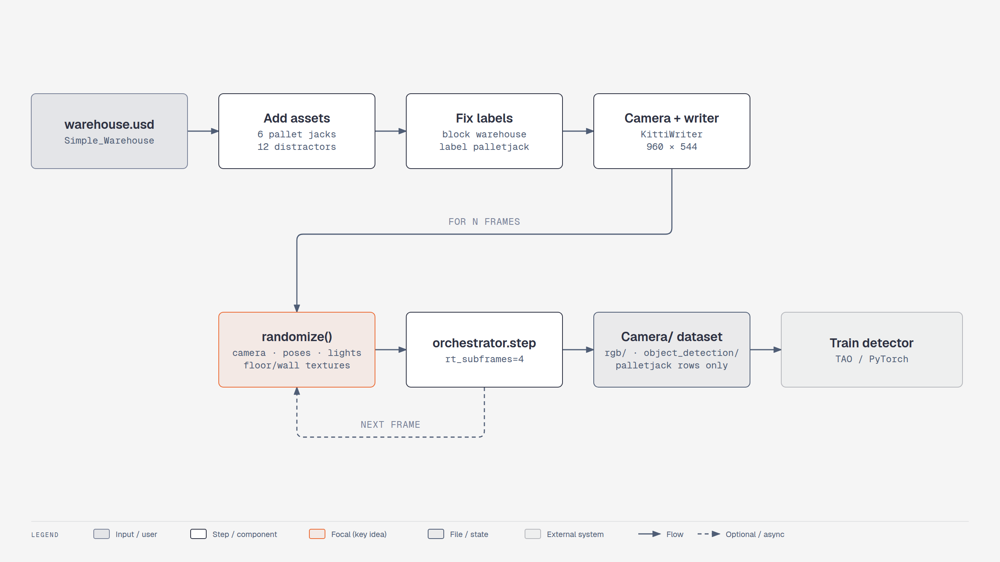
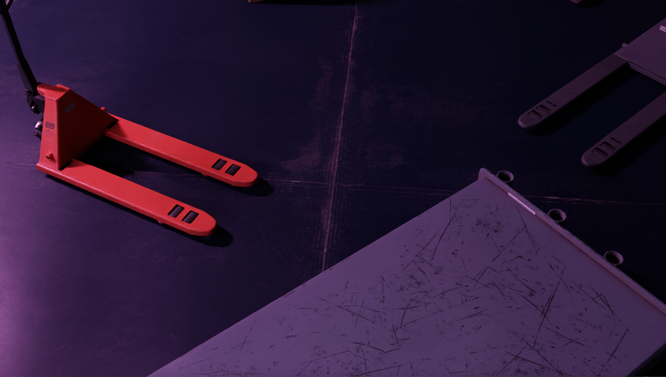

# Module 3: Synthetic Data Generation with Replicator (Isaac Sim 6.1)

Course pages: *Synthetic Data Generation for Perception Model Training in Isaac Sim*

| Course lesson | Version-specific? | Where |
|---|---|---|
| 1. Perception Models in Dynamic Robotic Tasks | no (concepts) | course site |
| 2. What Is Synthetic Data Generation? | no | course site |
| 3. Domain Randomization With Replicator | no (concepts: object / lighting / texture randomization, the sim-to-real gap) | course site |
| **4. Generating a Synthetic Dataset Using Replicator** | **yes** | **this page** |
| 5. Fine-Tuning and Validating an AI Perception Model | no (runs outside Isaac Sim, in TAO/PyTorch on the KITTI output) | course repo `local/` notebooks |

**Goal:** generate a KITTI-format dataset of **pallet jacks** in a warehouse, with randomized camera,
poses, colors, lights, floor/wall textures and distractor objects.

**Your mission:** make five images, inspect what changed, and decide whether their labels are usable
before creating a larger dataset. Generating files is the first checkpoint; judging the data is the
learning task.

**Script:** `scripts/m3_palletjack_sdg.py`, a 6.1 port of the course's
[`standalone_palletjack_sdg.py`](https://github.com/NVIDIA-AI-IOT/synthetic_data_generation_training_workflow/blob/main/palletjack_sdg/standalone_palletjack_sdg.py)
**Expected result:** `--headless --test` writes 5 different frames whose KITTI labels contain only
`palletjack` (in `learning_resource/output/palletjack_data/warehouse/Camera/`).


<!-- tutorial:start -->

> 🎬 **Video walkthrough:** [`3.1_synthetic_data.mp4`](../videos/3.1_synthetic_data.mp4) (captions burned in; text: [`.srt`](../videos/subtitles/3.1_synthetic_data.srt)) · ⏱ **Time:** 1 h (+ generation time)

**You will learn to**

- Explain **domain randomization** and the sim-to-real gap
- Drive Replicator with the **functional API** (the 6.1 pattern)
- Produce and inspect a **KITTI** detection dataset


*Pallet-jack dataset pipeline (6.1) — [interactive HTML](../diagrams/m3-sdg-pipeline.html)*

## Concepts
**Why synthetic data?** The simulator can generate annotations along with the rendered images,
reducing manual labelling. You still need to inspect class assignments, bounding boxes, and visibility.
Automatic annotation does not remove the need for dataset quality checks.

**Domain randomization.** Vary camera pose, lighting, textures, and distractors to discourage reliance
on accidental visual cues such as one background or one colour. This aims to improve robustness;
it does not guarantee transfer to real images. Two gaps to consider:
*appearance* (rendering realism) and *content* (scene variety).

**Replicator, two styles.** *Graph* style (`with rep.trigger.on_frame(): rep.modify.pose(...)`) builds an
OmniGraph that runs inside the orchestrator. *Functional* style (`rep.functional.modify.pose(prim, ...)`)
changes the stage immediately in Python, then `rep.orchestrator.step()` renders and writes one frame.
On this 6.1 build the functional style was the reliable one.

**Writers and annotators.** Annotators compute per-frame data (rgb, bounding boxes, segmentation);
writers (KittiWriter, BasicWriter, …) save annotator outputs in a dataset format.

<!-- tutorial:end -->

---

## Part 1: Run the generator

The course clones a repo and edits `generate_data.sh` to point at Isaac Sim. With 6.1 you can run the
ported script directly:

```bash
cd ~/isaacsim   # your Isaac Sim installation folder (contains isaac-sim.sh and python.sh)

# quick look with a window, 20 frames
./python.sh learning_resource/scripts/m3_palletjack_sdg.py --num_frames 20

# two supported dataset variants; inspect a small sample before these longer runs
./python.sh learning_resource/scripts/m3_palletjack_sdg.py --headless --num_frames 2000 --distractors warehouse
./python.sh learning_resource/scripts/m3_palletjack_sdg.py --headless --num_frames 1000 --distractors None
```

Options: `--height 544 --width 960` (course defaults), `--num_frames`, `--distractors warehouse|None`,
`--data_dir`, `--rt_subframes` (raise it if moving objects leave ghost trails).

The first run downloads the warehouse and pallet jacks from NVIDIA's asset server and compiles shaders,
so it's slow (minutes). Later runs are much faster.

> The course's `--distractors additional` set (hospital and office props) isn't included, because those
> asset paths moved between versions. Add your own with `rep.create.from_usd(...)`.

## Part 2: What the script does (and what changed)

The **randomizations are the course's**, with the same ranges: camera anywhere in the warehouse looking at
the centre, pallet jack colours and poses (×6, scale 0.01), distractor poses, RectLight colour/intensity/
visibility, and floor/wall textures. **How** they are applied changed:

| Step | Course (4.2/4.5) | 6.1 |
|---|---|---|
| Start app | `from omni.isaac.kit import SimulationApp`, `renderer: "RayTracedLighting"` | `from isaacsim import SimulationApp`, `renderer: "RealTimePathTracing"` |
| Asset root | `omni.isaac.core.utils.nucleus.get_assets_root_path` | `isaacsim.storage.native.get_assets_root_path` (→ `…/Assets/Isaac/6.1`) |
| Open warehouse | `omni.isaac.core.utils.stage.open_stage` | `omni.usd.get_context().open_stage` |
| Add pallet jacks / distractors | `rep.create.from_usd(url, semantics=…, count=2)` (graph API) | `rep.functional.create.reference(usd_path=url, semantics={"class": "palletjack"})` |
| Randomize | `with rep.trigger.on_frame(num_frames=N): rep.modify.pose(…)`, `rep.randomizer.color(…)`, `rep.create.material_omnipbr(…)` | 🔄 a plain Python `randomize()` that calls `rep.functional.modify.pose / attribute / visibility` with NumPy random numbers |
| Run | `rep.orchestrator.run()` + wait loops | 🔄 `for i in range(N): randomize(); rep.orchestrator.step(rt_subframes=4)` |
| Only label pallet jacks | custom `update_semantics()`: `prim.RemoveProperty()` on every non-palletjack `pxr.Semantics` label | 🔄 the warehouse labels come from **referenced** layers, which `RemoveProperty` can't delete, so the script **blocks** them (`attr.Block()`), labels the pallet jacks with `rep.functional.modify.semantics`, and drops leftover `Unlabelled` rows from the KITTI files (`KittiWriter(semantic_filter_predicate=…)` isn't applied by its fast bbox annotators in this build) |

**Why the functional API?** It's the pattern the 6.1 SDG examples use (`sdg_ur10_palletizing.py`,
`randomizing_textures.py`), and the graph pattern misbehaved on this 6.1 build:

* `rep.create.material_omnipbr` + `rep.randomizer.materials` inside the trigger **hung for more than 10 minutes**;
* graph randomizers driven by `rep.orchestrator.step()` **fired only on the first frame**, so every image was the same.
  (`on_frame(max_execs=N)` + `rep.orchestrator.run_until_complete()` does still randomize every frame.
  That's the closest equivalent to the course's `orchestrator.run()`, if you want to keep graph randomizers.)

## Part 3: Output

```
learning_resource/output/palletjack_data/<warehouse|None>/
├── metadata.txt
└── Camera/
    ├── rgb/                    ← training images (0.png, 1.png, …)
    ├── object_detection/       ← KITTI labels, one .txt per image ("palletjack 0.00 0 0.00 x1 y1 x2 y2 …")
    └── depth/ semantic/ semantic_segmentation/ instance_segmentation/   (extra annotators)
```

Look at a few images and label files, and check that each box surrounds a pallet jack. Many images are **dark**:
that's the course's lighting randomization (each warehouse light is on only 1 time in 7). Lower the 7 in
`randomize()` if you want brighter data.

### A sample from the actual run


*Unmodified RGB output from Isaac Sim 6.1, seed 42, frame 0. The label file
contains two pallet-jack boxes. Notice the partial object at the upper right: inspect the labels as
well as the most obvious red object.*

A five-frame run with seed 42 gives five different images and only `palletjack` labels, but also
one almost-black frame (mean RGB ≈ 5/255), one overexposed frame (≈ 253/255), and one frame with no
labelled detections. **Passing the smoke test does not make the data ready for training** — review
lighting, visibility and camera framing before a long run.

### Inspect before scaling up

Choose one bright frame, one dark frame, and one with an object partly hidden. Draw the KITTI boxes
on each image (fields 5–8 are `x1, y1, x2, y2`, using one-based field numbering). Check that the class
is correct, coordinates are within the image, and the boxes match the intended objects. Keep images
with no detections visible in your review too: an empty label file deserves inspection.

**Predict and compare:** change one lighting parameter, generate another small sample, and explain
what became easier or harder to see. Keep the seed and other settings fixed for the comparison.
Decide what variation your intended camera actually needs before increasing the frame count.

## Part 4: Semantic labels in the GUI (optional part of the lesson)

* 🔄 **Tools > Replicator > Semantics Schema Editor** (4.2: enable it under Window > Extensions).
  * *Selected objects*: set **Type** `class`, **Data** = your label.
  * *Prim names*: generate labels from prim names, stripping prefixes like `SM_` / `SK_`.
* In code (6.1):
  ```python
  import omni.replicator.core as rep
  rep.functional.modify.semantics(prim, {"class": "avocado"}, mode="add")   # new functional API
  # graph API (still works inside rep.trigger blocks):  rep.modify.semantics([("class", "avocado")])
  ```
* Filters: `class:vehicle|person` (either), `!class:sports_car` (exclude).

## Part 5: Train / validate (course lesson 5)

This part runs **outside Isaac Sim**, so nothing changes for 6.1. Use the KITTI folders above as the
dataset in the course repo's notebook (`synthetic_data_generation_training_workflow/local/`).

## Going further in 6.1

`standalone_examples/api/isaacsim.replicator.examples/` has the current recommended patterns:
`sdg_getting_started_01…05.py` (writers, annotators, functional API), `randomizing_textures.py`,
`randomizing_light_sources.py`, `simready_assets_sdg.py`, `cosmos_writer_simple.py`.

<!-- practice:start -->

## Check your result

| Do this | You should see |
|---|---|
| `m3_palletjack_sdg.py --headless --test` | `PASS: randomized, palletjack-only KITTI data` |
| `Camera/rgb/*.png` | different viewpoints, pallet jacks in varying colours/poses |
| `Camera/object_detection/*.txt` | only `palletjack` rows |

## Exercises

1. Add a **DomeLight** with random intensity so fewer frames are dark.
2. Add a second class (`class: cone` on the traffic cones) and keep both classes in the labels.
3. Write a 10-line script that draws the KITTI boxes on `rgb/0.png` to check them visually.

## Quiz

1. Why randomize the floor texture when we only care about pallet jacks?
   <details><summary>Answer</summary>To discourage dependence on one background. Test whether it helps on held-out images; randomization alone does not guarantee robustness.</details>

2. What does `rep.orchestrator.step()` do?
   <details><summary>Answer</summary>Renders one frame and lets attached writers save it.</details>

3. Why did the course's `update_semantics()` not remove the warehouse labels in 6.1?
   <details><summary>Answer</summary>They come from referenced layers; RemoveProperty can't delete those — the script blocks them.</details>

<!-- practice:end -->
