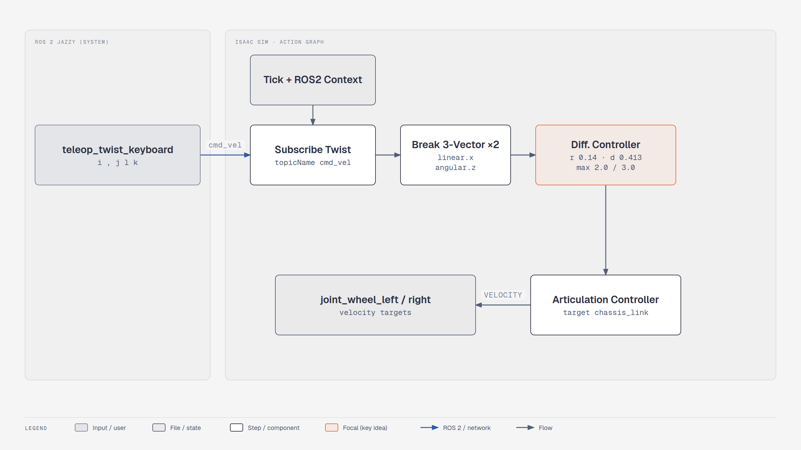

# Lesson 4.1: Using OmniGraph to Drive a Robot from ROS 2 (Isaac Sim 6.1)

Course page: *Developing Robots With SIL → Using OmniGraph to Drive a Robot in Isaac Sim*
(`…/developing-robots-with-sil-in-isaac-sim/03-using-omnigraph-to-drive-a-robot-in-isaac-sim.html`)

The concept lessons before it (*Intelligent Robots*, *Software-in-the-Loop*) apply to any version.
Read them on the course site.

**Goal:** Nova Carter in the Simple Room, driven by ROS 2 `geometry_msgs/Twist` messages on `/cmd_vel`
(from `ros2 topic pub` or `teleop_twist_keyboard`).

**Checkpoint script:** `scripts/m4_nova_carter_cmd_vel.py`
**Expected result:** publishing `linear.x = 0.5` on `/cmd_vel` moves Nova Carter more than 1 m in
about 3.5 s (the checkpoint publishes real ROS 2 messages and checks this).


<!-- tutorial:start -->

> 🎬 **Video walkthrough:** [`4.1_omnigraph_cmd_vel.mp4`](../videos/4.1_omnigraph_cmd_vel.mp4) (captions burned in; text: [`.srt`](../videos/subtitles/4.1_omnigraph_cmd_vel.srt)) · ⏱ **Time:** 45 min

**You will learn to**

- Build a ROS 2 **subscriber** Action Graph by hand
- Drive a simulated robot from standard ROS tools (`ros2 topic pub`, teleop)
- Explain software-in-the-loop (SIL)


*Driving Nova Carter from /cmd_vel — [interactive HTML](../diagrams/m4-cmd-vel.html)*

## Concepts
**Software-in-the-loop.** The robot software runs unchanged; only its inputs (sensors) and outputs
(actuators) are connected to a simulator instead of hardware. `/cmd_vel` (`geometry_msgs/Twist`) is the
standard ROS interface for "drive with this velocity", so anything that drives a real mobile base
(teleop, Nav2, your planner) can drive the simulated one.

**Twist.** `linear.x` = forward m/s, `angular.z` = yaw rate rad/s; the other four fields are unused for a
differential-drive robot — hence the two *Break 3-Vector* nodes picking `x` and `z`.

<!-- tutorial:end -->

---

## Part 1: Scene

1. `./isaac-sim.sh` → **File > New**.
2. 🔄 Environment: **Create > Environments > Simple Room**
   (or **Window > Browsers > Isaac Sim Assets** → *Environments* → `simple_room.usd` → right-click → *Add at current selection*).
   Zero its Translate.
3. 🔄 Robot: **Create > Robots > Nova Carter with Sensors**. Move it next to the table and raise it slightly.
4. **Play** and check it drops onto the floor. **Stop**.

## Part 2: Action Graph

1. Right-click **nova_carter** → **Create > Visual Scripting > Action Graph**, then open it
   (**Window > Graph Editors > Action Graph**, or right-click the graph → *Open Graph*).
2. Add these nodes (search box in the graph editor; ROS nodes are in the *Isaac Ros2* category):

   | Node | 6.1 type id |
   |---|---|
   | On Playback Tick | `omni.graph.action.OnPlaybackTick` |
   | ROS2 Context | `isaacsim.ros2.bridge.ROS2Context` |
   | ROS2 Subscribe Twist | `isaacsim.ros2.bridge.ROS2SubscribeTwist` |
   | Scale To/From Stage Units | `isaacsim.core.nodes.OgnIsaacScaleToFromStageUnit` (optional, stage is already in metres) |
   | Break 3-Vector ×2 | `omni.graph.nodes.BreakVector3` |
   | Differential Controller | `isaacsim.robot.wheeled_robots.DifferentialController` |
   | Articulation Controller | `isaacsim.core.nodes.IsaacArticulationController` |
   | Make Array + Constant Token ×2 | joint names (or type them straight into the Articulation Controller's *jointNames*) |

3. Wire it up. The course only shows this in a picture, so here it is in text:

   ```
   On Playback Tick.tick ───────────────► ROS2 Subscribe Twist.execIn
   ROS2 Context.context ────────────────► ROS2 Subscribe Twist.context
   ROS2 Subscribe Twist.execOut ────────► Differential Controller.execIn
   ROS2 Subscribe Twist.linearVelocity ─► [Scale To/From Stage Units] ─► Break 3-Vector #1.tuple
   ROS2 Subscribe Twist.angularVelocity ► Break 3-Vector #2.tuple
   Break 3-Vector #1.x ─────────────────► Differential Controller.linearVelocity
   Break 3-Vector #2.z ─────────────────► Differential Controller.angularVelocity
   On Playback Tick.tick ───────────────► Articulation Controller.execIn
   Differential Controller.velocityCommand ► Articulation Controller.velocityCommand
   Constant Token "joint_wheel_left"  ─┐
   Constant Token "joint_wheel_right" ─┴► Make Array ─► Articulation Controller.jointNames
   ```

4. Properties:

   | Node | Property | Value |
   |---|---|---|
   | ROS2 Subscribe Twist | topicName | `cmd_vel` |
   | Differential Controller | maxLinearSpeed / maxAngularSpeed | **2.0** / **3.0** |
   | | wheelDistance / wheelRadius | **0.413** / **0.14** |
   | Articulation Controller | targetPrim | *Add Target* → **nova_carter > chassis_link** (the articulation root) |
   | Constant Token 1 / 2 | value | `joint_wheel_left` / `joint_wheel_right` |

## Part 3: Drive it from ROS 2

> 🔄 Course: Humble, `source /opt/ros/humble/setup.bash` before launching Isaac Sim, and a *ROS1 vs ROS2
> bridge* fallback. 6.1: no sourcing needed for Isaac Sim (bundled Jazzy), and ROS 1 is gone.
> Install system **Jazzy** only for the CLI: [`01_setup_ros2_jazzy.md`](../01_setup_ros2_jazzy.md).

1. **Play** in Isaac Sim.
2. Terminal:
   ```bash
   source /opt/ros/jazzy/setup.bash
   ros2 topic list                         # /cmd_vel, /parameter_events, /rosout
   ros2 topic pub --once /cmd_vel geometry_msgs/msg/Twist "{linear: {x: 0.2}}"     # forward
   ros2 topic pub --once /cmd_vel geometry_msgs/msg/Twist "{}"                      # stop
   ```
3. Keyboard teleop (`sudo apt install ros-jazzy-teleop-twist-keyboard`):
   ```bash
   ros2 run teleop_twist_keyboard teleop_twist_keyboard
   ```
   `i` forward · `,` back · `j` rotate left · `l` rotate right · `k` stop.

## Checkpoint

```bash
./python.sh learning_resource/scripts/m4_nova_carter_cmd_vel.py            # builds the scene + graph, keeps playing
./python.sh learning_resource/scripts/m4_nova_carter_cmd_vel.py --headless --test
```

## Troubleshooting

| Symptom | Fix |
|---|---|
| `/cmd_vel` not listed | Not playing, or `ROS_DOMAIN_ID` / RMW differ between terminals (`export RMW_IMPLEMENTATION=rmw_fastrtps_cpp`) |
| Messages arrive but the robot doesn't move | Articulation Controller target isn't **chassis_link**, or the joint names are misspelled |
| Robot moves only once per message | Expected with `--once`. Teleop republishes continuously |
| Robot drives in a circle | Left/right joint names swapped |

<!-- practice:start -->

## Check your result

| Do this | You should see |
|---|---|
| `ros2 topic list` while playing | `/cmd_vel` |
| `ros2 topic pub --once /cmd_vel … x: 0.2` | Carter rolls forward |
| `m4_nova_carter_cmd_vel.py --headless --test` | `[m4] PASS: Nova Carter follows /cmd_vel` |

## Exercises

1. Add an **Odometry** publisher (Tools > Robotics > ROS 2 OmniGraphs > Odometry Publisher) and watch `/odom` while driving.
2. Publish `/cmd_vel` at 10 Hz with `ros2 topic pub -r 10 …` and stop the publisher. Does Carter keep driving? What would a real base do (watchdog)?

## Quiz

1. Which two Twist fields does a differential-drive robot use?
   <details><summary>Answer</summary>linear.x and angular.z.</details>

2. What is the Articulation Controller's target for Nova Carter?
   <details><summary>Answer</summary>`chassis_link`, the articulation root.</details>

<!-- practice:end -->
