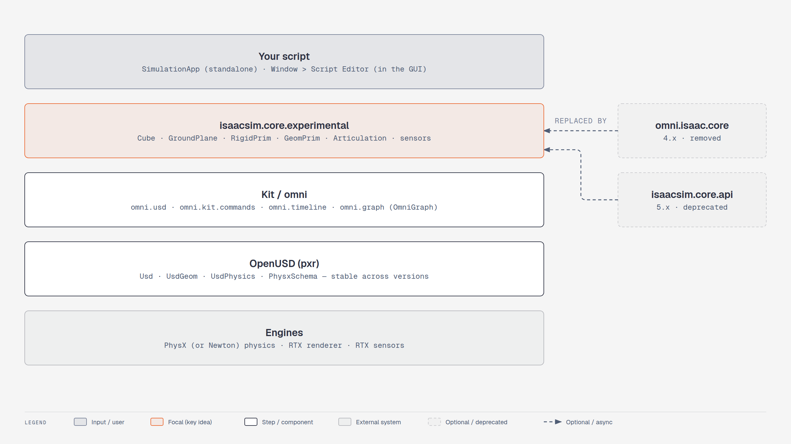

# Lesson 4.2: Foundations of Isaac Sim Scripting With Python (Isaac Sim 6.1)

Course page: *Developing Robots With SIL → Foundations of Isaac Sim Scripting With Python*
(`…/04-foundations-of-isaac-sim-scripting-with-python.html`)

**Goal:** create the same scene (physics + ground + falling cube) three ways: USD API, the Isaac Sim
Core API, and a standalone script.

**Files:** `scripts/m4_snippet_usd_api.py`, `scripts/m4_snippet_core_api.py`, `scripts/m4_run_snippet.py`
**Expected result:** with either snippet the cube falls from z = 1.0 and rests at z = 0.25.


<!-- tutorial:start -->

> 🎬 **Video walkthrough:** [`4.2_python_scripting.mp4`](../videos/4.2_python_scripting.mp4) (captions burned in; text: [`.srt`](../videos/subtitles/4.2_python_scripting.srt)) · ⏱ **Time:** 45 min

**You will learn to**

- Run code in the **Script Editor** and as a **standalone app**
- Choose between raw **USD** and the **6.1 core API**
- Port 4.x `omni.isaac.core` code


*The Python layers you script against — [interactive HTML](../diagrams/m4-python-layers.html)*

## Concepts
**Two ways to run Python.** *Script Editor*: inside the running GUI, shares its stage — good for poking.
*Standalone* (`./python.sh my.py`): your script owns the app loop via `SimulationApp`, can run headless,
and is how tests, data generation and RL run.

**Rule #1 of standalone scripts.** Create `SimulationApp(...)` **before** importing anything from
`isaacsim.*`/`omni.*` (those modules only exist once Kit is running).

**Which API?** Raw `pxr` USD is verbose but never changes between versions. `isaacsim.core.experimental`
is concise and batched (operate on many prims at once, NumPy/Torch/Warp arrays) — the 6.x way.

<!-- tutorial:end -->

---

## Part 1: Script Editor (unchanged)

**Window > Script Editor.**

* **Run** or **Ctrl+Enter** runs the whole tab. Select some lines and use **Run Selected** to run only those.
* **Tab > Add Tab** opens more tabs. All tabs share one Python environment, so a variable defined in
  one tab is visible in the others.

## Part 2: USD API workflow (course code works as-is ✅)

1. **File > New**.
2. Paste [`scripts/m4_snippet_usd_api.py`](../scripts/m4_snippet_usd_api.py) into the Script Editor → **Ctrl+Enter**.
3. A ground plane and a cube appear. **Play**, and the cube falls.

`pxr` (`Usd`, `UsdGeom`, `UsdPhysics`, `PhysxSchema`) is the stable foundation under Isaac Sim. Code
written against it keeps working across versions. Run it **once per empty stage**.

## Part 3: Isaac Sim Core API workflow (🔄 rewritten for 6.1)

The course's code **doesn't run in 6.1**:

```python
# ❌ 4.2 course code: omni.isaac.core no longer exists in 6.1
from omni.isaac.core.objects import DynamicCuboid
from omni.isaac.core.objects.ground_plane import GroundPlane
from omni.isaac.core.physics_context import PhysicsContext
```

The 6.1 equivalent ([`scripts/m4_snippet_core_api.py`](../scripts/m4_snippet_core_api.py)):

```python
from isaacsim.core.experimental.materials import PreviewSurfaceMaterial
from isaacsim.core.experimental.objects import Cube, GroundPlane
from isaacsim.core.experimental.prims import GeomPrim, RigidPrim
from pxr import UsdPhysics
import omni.usd

stage = omni.usd.get_context().get_stage()
if not any(p.IsA(UsdPhysics.Scene) for p in stage.Traverse()):   # = PhysicsContext()
    UsdPhysics.Scene.Define(stage, "/World/PhysicsScene")

GroundPlane("/World/groundPlane", sizes=10)

cube = Cube("/World/cube", sizes=1.0, positions=[-0.5, -0.2, 1.0], scales=[0.5, 0.5, 0.5])
material = PreviewSurfaceMaterial("/World/Looks/cube_color")
material.set_input_values("diffuseColor", [0.2, 0.3, 0.0])
cube.apply_visual_materials(material)
RigidPrim(cube.paths)                              # makes it dynamic (= "DynamicCuboid")
GeomPrim(cube.paths, apply_collision_apis=True)    # gives it a collider
```

What changed:

| 4.2 / 4.5 | 6.1 | Note |
|---|---|---|
| `DynamicCuboid(...)` (shape + physics in one) | `Cube(...)` + `RigidPrim(...)` + `GeomPrim(..., apply_collision_apis=True)` | 6.1 splits *geometry*, *rigid body* and *collider* into separate wrappers |
| `position=np.array([...])` | `positions=[...]` | 6.1 wrappers are **batched**: plural argument names, and they accept lists of paths |
| `color=np.array([...])` | a `PreviewSurfaceMaterial` + `apply_visual_materials` | |
| `PhysicsContext()` | a `UsdPhysics.Scene` prim (or `isaacsim.core.simulation_manager.SimulationManager`) | |

Steps: **File > New From Stage Template > Empty** → *Don't Save* → paste → **Ctrl+Enter** → **Play**.

## Part 4: Standalone Python (bonus, not in the course)

Real SIL setups usually run Isaac Sim from a script, not the GUI. Every file in `scripts/` is a
standalone app:

```python
from isaacsim import SimulationApp                  # 4.2: from omni.isaac.kit import SimulationApp
simulation_app = SimulationApp({"headless": False})  # must come BEFORE any other isaacsim/omni import

import omni.timeline
# ... build the stage ...
omni.timeline.get_timeline_interface().play()
while simulation_app.is_running():
    simulation_app.update()                          # one rendered + simulated frame
simulation_app.close()
```

Run a Script Editor snippet as a standalone app:

```bash
./python.sh learning_resource/scripts/m4_run_snippet.py learning_resource/scripts/m4_snippet_core_api.py
./python.sh learning_resource/scripts/m4_run_snippet.py learning_resource/scripts/m4_snippet_usd_api.py --headless --test
```

More 6.1 examples to read next:

| File (under `standalone_examples/`) | Shows |
|---|---|
| `api/isaacsim.simulation_app/hello_world.py` | the smallest possible app |
| `api/isaacsim.core.experimental.api/add_cubes.py` | rigid bodies, materials, resetting state |
| `api/isaacsim.core.experimental.api/control_robot_numpy.py` | articulation control with the 6.1 API |
| `api/isaacsim.ros2.bridge/subscriber.py` | rclpy inside Isaac Sim |
| `tutorials/getting_started/getting_started_robot.py` | loading and moving a robot |

<!-- practice:start -->

## Check your result

| Do this | You should see |
|---|---|
| USD snippet in Script Editor + Play | cube falls and rests at z = 0.25 |
| Core API snippet in Script Editor + Play | same |
| `m4_run_snippet.py … --headless --test` | `[m4] PASS: cube fell …` |

## Exercises

1. Extend the core-API snippet to create 10 cubes in a row with **one** `Cube(...)` call (pass a list of paths and positions).
2. Turn `m4_snippet_core_api.py` into a standalone script that prints the cube height every 10 frames.
3. Read `standalone_examples/api/isaacsim.core.experimental.api/add_cubes.py` and explain `RigidPrim.set_velocities`.

## Quiz

1. What must be the first Isaac Sim import in a standalone script?
   <details><summary>Answer</summary>`from isaacsim import SimulationApp`, then create it.</details>

2. 4.x `DynamicCuboid` in 6.1?
   <details><summary>Answer</summary>`Cube` + `RigidPrim` + `GeomPrim(apply_collision_apis=True)`.</details>

3. Which layer's code survived 4.2 → 6.1 unchanged?
   <details><summary>Answer</summary>Raw OpenUSD (`pxr`) code.</details>

<!-- practice:end -->
