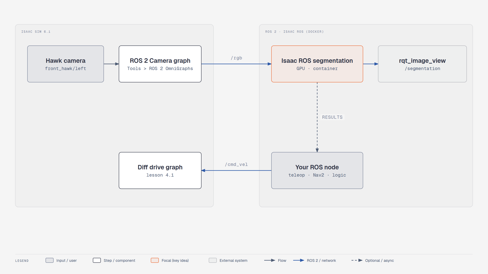

# Lesson 4.3: Publish camera images for Isaac ROS

Your robot software needs to see the scene before it can interpret it. In this lesson, publish Nova
Carter's camera and check that an external ROS 2 viewer receives the images.

**Finish line for this page:** a live camera image in `rqt_image_view`. Running a segmentation model
is an external continuation, not a result established by this camera check. The existing video also
introduces that wider workflow.

<!-- tutorial:start -->

> 🎬 **Video walkthrough:** [`4.3_isaac_ros_segmentation.mp4`](../videos/4.3_isaac_ros_segmentation.mp4) (captions burned in; text: [`.srt`](../videos/subtitles/4.3_isaac_ros_segmentation.srt)) · ⏱ **Time:** 20–30 min estimated for the camera check; allow additional time for external Isaac ROS setup

**You will learn to**

- Publish simulated camera images to ROS 2
- Identify the camera feed needed by an external Isaac ROS pipeline


*Software-in-the-loop with Isaac ROS — [interactive HTML](../diagrams/m4-sil-segmentation.html)*

## Concepts
**Camera graphs.** A camera publisher needs a *render product* (the camera rendered at a resolution); the
*ROS 2 Camera* tool creates it plus the publisher nodes for RGB, depth, segmentation or boxes.

**Containers and distros.** Isaac ROS runs in Docker, often on Humble. DDS lets Humble and Jazzy exchange
standard messages if RMW and domain ID match; when in doubt, run Isaac Sim with the same distro.

<!-- tutorial:end -->


Course pages: *Developing Robots With SIL →*
*Foundations of Image Segmentation, ROS 2, and Isaac ROS* · *Image Segmentation Without Simulation* ·
*Image Segmentation With Simulation*

These lessons run **Isaac ROS** (a Docker-based ROS 2 workspace) next to Isaac Sim. Most of the work
happens in Isaac ROS, so follow the course pages for that part. Only the Isaac Sim side changes:

## What changes on the Isaac Sim side

| Course | 6.1 |
|---|---|
| ROS 2 Humble everywhere | Isaac Sim publishes with its bundled **Jazzy** libs. ROS 2 talks across distros at the DDS level for standard messages (`sensor_msgs/Image`, `CameraInfo`), but **keep the same RMW** (`rmw_fastrtps_cpp`) and `ROS_DOMAIN_ID` on both sides. If the Isaac ROS container is Humble and messages don't arrive, launch Isaac Sim with the container's distro: `export ROS_DISTRO=humble` before `./isaac-sim.sh` (6.1 bundles both `humble` and `jazzy` libs under `exts/isaacsim.ros2.core/`) |
| Camera → ROS graph built by hand or via *Isaac Utils > ROS2 OmniGraphs > Camera* | 🔄 **Tools > Robotics > ROS 2 OmniGraphs > Camera**. Pick the camera prim and tick **RGB** (+ optional Depth, Semantic, Instance, BBox). Topics default to `rgb`, `depth`, … with Frame ID `sim_camera` |
| Nova Carter cameras | Same asset (*Create > Robots > Nova Carter with Sensors*). Hawk/Owl cameras live under `chassis_link/sensors/…` |

## Quick check: camera to ROS 2

1. Scene from lesson 4.1 (Nova Carter in the Simple Room).
2. **Tools > Robotics > ROS 2 OmniGraphs > Camera** → *Camera Prim* = e.g.
   `/World/nova_carter/chassis_link/sensors/front_hawk/left/camera_left`, tick **RGB**, OK.
3. **Play**, then:
   ```bash
   source /opt/ros/jazzy/setup.bash
   ros2 topic hz /rgb
   ros2 run rqt_image_view rqt_image_view /rgb
   ```

A scripted version of this graph is in
`standalone_examples/api/isaacsim.ros2.bridge/camera_periodic.py` (run it with `./python.sh`).

## Continue to model inference

Use the *Image Segmentation Without Simulation* and *Image Segmentation With Simulation* lessons
in the [original NVIDIA learning path](https://docs.nvidia.com/learning/physical-ai/getting-started-with-isaac-sim/latest/)
for the Isaac ROS environment and model setup. Return to this feed once inference works on the
example input used there.

For that continuation, keep an RGB frame and the model's predicted mask side by side. Record the
input/output topics and describe at least one visible mistake. Simulator-generated semantic labels
are ground truth from the scene; they are not evidence that a segmentation model ran successfully.

<!-- practice:start -->

## Check your result

| Do this | You should see |
|---|---|
| `ros2 topic hz /rgb` | a steady rate while playing |
| `rqt_image_view /rgb` | the Hawk camera image |

## Exercises

1. Also publish `depth` and view it in RViz as an Image display.
2. Lower the camera resolution in the dialog and compare `/rgb` rates.

## Quiz

1. What does a camera publisher need besides the camera prim?
   <details><summary>Answer</summary>A render product.</details>

2. Isaac ROS on Humble, Isaac Sim on Jazzy, no messages — one fix?
   <details><summary>Answer</summary>Launch Isaac Sim with `ROS_DISTRO=humble` (bundled) and matching RMW/domain.</details>

<!-- practice:end -->
