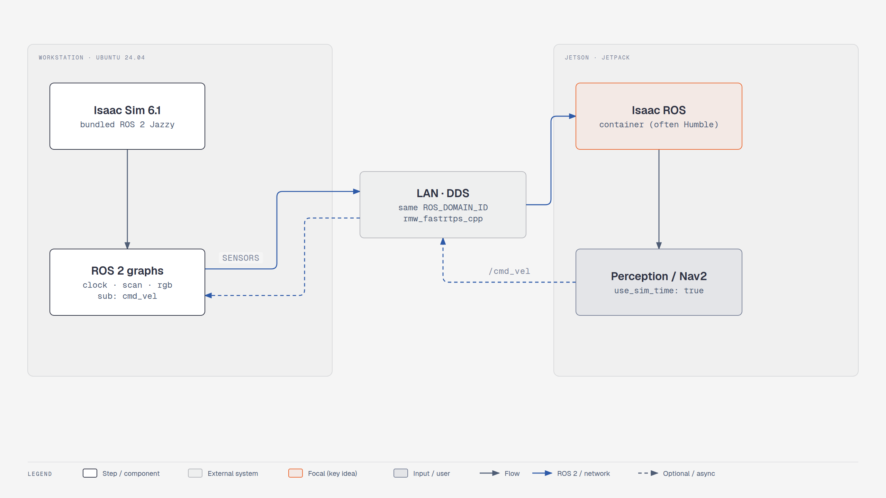

# Module 5: Leveraging ROS 2 and Hardware-in-the-Loop (notes for Isaac Sim 6.1)

<!-- tutorial:start -->

> 🎬 **Video walkthrough:** [`5_hardware_in_the_loop.mp4`](../videos/5_hardware_in_the_loop.mp4) (captions burned in; text: [`.srt`](../videos/subtitles/5_hardware_in_the_loop.srt)) · ⏱ **Time:** reading 15 min (hands-on needs a Jetson)

**You will learn to**

- Explain hardware-in-the-loop (HIL)
- Prepare the Isaac Sim side for a Jetson

*Hardware-in-the-loop deployment — [interactive HTML](../diagrams/m5-hil.html)*

## Concepts
**HIL vs SIL.** In SIL the robot software runs on your workstation; in HIL it runs on the robot's real
computer (Jetson), so you also test its timing, GPU load and networking — without risking the robot.

**Simulated time.** The simulator may run slower or faster than real time. Publishing `/clock` and
setting `use_sim_time: true` on the Jetson keeps every node on the simulator's clock.

<!-- tutorial:end -->

Course pages: *Leveraging ROS 2 and HIL in Isaac Sim*: HIL fundamentals, Jetson overview, Jetson
environment setup, deploying Isaac ROS on Jetson.

This module is mostly about the **NVIDIA Jetson** board (JetPack, Isaac ROS containers). Isaac Sim
plays the same role it did in Module 4: it publishes sensor topics and subscribes to `/cmd_vel`.
You need Jetson hardware to do it hands-on, so there's no checkpoint script.

## Isaac Sim side: what to keep in mind with 6.1

1. **Network:** the Jetson and this PC must share a network, the same `ROS_DOMAIN_ID` and the same RMW
   (`rmw_fastrtps_cpp` by default). Test with `ros2 topic list` on the Jetson while Isaac Sim is playing.
2. **ROS distro:** JetPack/Isaac ROS images are often Humble. If Jazzy (Isaac Sim) ↔ Humble (Jetson)
   messages don't arrive, start Isaac Sim with `export ROS_DISTRO=humble` (bundled libs for both
   distros are in `exts/isaacsim.ros2.core/`).
3. **Sim time:** add a clock publisher (**Tools > Robotics > ROS 2 OmniGraphs > Clock**, or
   `standalone_examples/api/isaacsim.ros2.bridge/clock.py`) and set `use_sim_time: true` on the Jetson nodes.
4. **Graphs:** reuse lesson 4.1 (`/cmd_vel`), lesson 1.4 (lidar) and lesson 4.3 (camera). The menu
   paths are all under **Tools > Robotics > ROS 2 OmniGraphs** in 6.1.
5. **Navigation (Nav2):** 6.1 ships ready-made scenes: **Window > Examples > Robotics Examples** →
   *ROS2 > Navigation*, e.g. `carter_warehouse_navigation.usd`.

Follow the course pages for the Jetson setup itself (JetPack, Docker, Isaac ROS).

<!-- practice:start -->

## Check your result

| Do this | You should see |
|---|---|
| On the Jetson: `ros2 topic list` | Isaac Sim's topics (clock, scan, rgb) |
| On the Jetson: `ros2 topic hz /clock` | steady rate while Isaac Sim plays |

## Exercises

1. Without a Jetson: run the 'Jetson side' in a second terminal (or Docker) on the same PC with `use_sim_time:=true` and check it follows `/clock`.

## Quiz

1. What does `use_sim_time: true` do?
   

Answer
Nodes use the /clock topic instead of the wall clock.

2. Two settings that must match on both machines?
   

Answer
ROS_DOMAIN_ID and the RMW implementation.

<!-- practice:end -->
